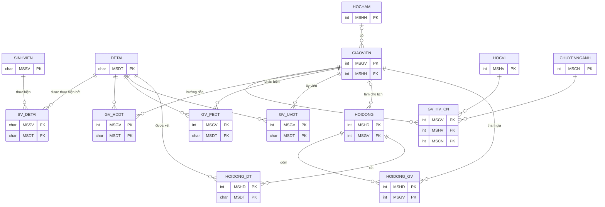

# BTTH6 – Bài tập tổng hợp (Câu 1 và Câu 3)

**Môn học:** IE103 – Quản lý Thông tin  
**Sinh viên:** Họ tên – MSSV  
**Môi trường:** Microsoft SQL Server 2022 – file `MSSV_HoTen_BTTH6.sql` (chạy trọn vẹn từ đầu đến cuối)

---

## Câu 1. Tổ chức/Biểu diễn thông tin

### 1.1. Sơ đồ ERD của CSDL QLĐT



Ghi chú: sơ đồ chỉ hiển thị khóa; các thuộc tính còn lại như bảng 1.1 của BTTH2. `SV_DETAI` không có khóa chính (theo đề). Sáu bảng `GV_HV_CN`, `GV_HDDT`, `GV_PBDT`, `GV_UVDT`, `HOIDONG_GV`, `HOIDONG_DT` là các quan hệ n–n được tách thành bảng riêng.

---

## Câu 3. An ninh thông tin

### 3.1. Tạo 3 user

```sql
USE master
GO
IF SUSER_ID('GIANGVIEN') IS NOT NULL DROP LOGIN GIANGVIEN
IF SUSER_ID('GIAOVU')    IS NOT NULL DROP LOGIN GIAOVU
IF SUSER_ID('SINHVIEN')  IS NOT NULL DROP LOGIN SINHVIEN
GO
CREATE LOGIN GIANGVIEN WITH PASSWORD = 'GiangVien@123', CHECK_POLICY = OFF
CREATE LOGIN GIAOVU    WITH PASSWORD = 'GiaoVu@123',    CHECK_POLICY = OFF
CREATE LOGIN SINHVIEN  WITH PASSWORD = 'SinhVien@123',  CHECK_POLICY = OFF
GO
USE QLDT
GO
CREATE USER GIANGVIEN FOR LOGIN GIANGVIEN
CREATE USER GIAOVU    FOR LOGIN GIAOVU
CREATE USER SINHVIEN  FOR LOGIN SINHVIEN
GO
```

Mật khẩu: `GiangVien@123`, `GiaoVu@123`, `SinhVien@123`. Mỗi user gồm một LOGIN (cấp server) và một USER (cấp CSDL QLDT).

### 3.2. Phân quyền

```sql
GRANT SELECT, INSERT, UPDATE ON SCHEMA::dbo TO GIAOVU

GRANT SELECT ON GIAOVIEN    TO GIANGVIEN
GRANT SELECT ON HOCVI       TO GIANGVIEN
GRANT SELECT ON HOCHAM      TO GIANGVIEN
GRANT SELECT ON CHUYENNGANH TO GIANGVIEN
GRANT SELECT ON GV_HV_CN    TO GIANGVIEN
GRANT SELECT ON GV_HDDT     TO GIANGVIEN
GRANT SELECT ON GV_PBDT     TO GIANGVIEN
GRANT SELECT ON GV_UVDT     TO GIANGVIEN
GRANT SELECT ON HOIDONG     TO GIANGVIEN
GRANT SELECT ON HOIDONG_GV  TO GIANGVIEN
GRANT SELECT ON HOIDONG_DT  TO GIANGVIEN
GRANT SELECT ON DETAI       TO GIANGVIEN
GRANT UPDATE ON GIAOVIEN    TO GIANGVIEN

GRANT SELECT ON SINHVIEN    TO SINHVIEN
GRANT SELECT ON SV_DETAI    TO SINHVIEN
GRANT SELECT ON HOIDONG     TO SINHVIEN
GRANT SELECT ON HOIDONG_GV  TO SINHVIEN
GRANT SELECT ON HOIDONG_DT  TO SINHVIEN
GRANT SELECT ON DETAI       TO SINHVIEN

DENY DELETE ON SCHEMA::dbo TO GIANGVIEN, GIAOVU, SINHVIEN
GO
```

### Kết quả chạy thử

Chạy bằng `EXECUTE AS USER`; thao tác ghi đều được ROLLBACK.

| User | Thao tác | Kết quả |
|---|---|---|
| GIAOVU | SELECT HOCVI | Được phép |
| GIAOVU | UPDATE SINHVIEN | Được phép |
| GIAOVU | INSERT HOCVI | Được phép |
| GIAOVU | DELETE HOCVI | BỊ TỪ CHỐI |
| GIANGVIEN | SELECT GV_HDDT | Được phép |
| GIANGVIEN | SELECT SINHVIEN | BỊ TỪ CHỐI |
| GIANGVIEN | UPDATE GIAOVIEN | Được phép |
| GIANGVIEN | UPDATE DETAI | BỊ TỪ CHỐI |
| GIANGVIEN | DELETE GIAOVIEN | BỊ TỪ CHỐI |
| SINHVIEN | SELECT SINHVIEN | Được phép |
| SINHVIEN | SELECT HOIDONG | Được phép |
| SINHVIEN | SELECT DETAI | Được phép |
| SINHVIEN | SELECT GIAOVIEN | BỊ TỪ CHỐI |
| SINHVIEN | UPDATE SINHVIEN | BỊ TỪ CHỐI |
| SINHVIEN | DELETE SINHVIEN | BỊ TỪ CHỐI |

**Lưu ý:**
- `DENY DELETE` đặt ở mức schema nên áp dụng cho mọi bảng, kể cả `GIAOVU`.
- Quyền "GIANGVIEN cập nhật thông tin của mình" được cấp bằng `GRANT UPDATE ON GIAOVIEN`. Cách này chưa giới hạn riêng dòng của chính giảng viên đó; muốn giới hạn cần thêm view lọc theo `SUSER_SNAME()`.
- `SINHVIEN` được thêm quyền xem `SV_DETAI` để biết sinh viên làm đề tài nào.
