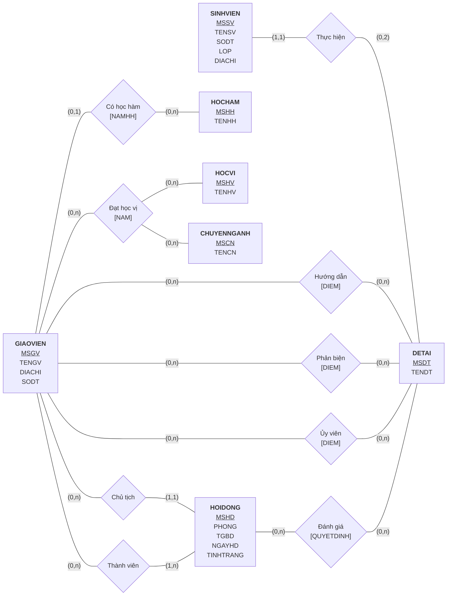

# BÀI TẬP THỰC HÀNH TUẦN 6: BÀI TẬP TỔNG HỢP

**Môn học:** IE103 – Quản lý Thông tin
**Sinh viên:** Họ tên – MSSV
**Môi trường thực hiện:** Microsoft SQL Server 2022
**File mã nguồn kèm theo:** `MSSV_HoTen_BTTH6.sql` (chạy được trọn vẹn từ đầu đến cuối)

---

## Chuẩn bị: CSDL Quản lý đề tài (QLDT)

Phần đầu file `.sql` (Câu 0) tạo lại CSDL `QLDT` theo đúng lược đồ, kiểu dữ liệu và dữ liệu mẫu của BTTH2. CSDL gồm 14 quan hệ:

- SINHVIEN(<u>MSSV</u>, TENSV, SODT, LOP, DIACHI)
- DETAI(<u>MSDT</u>, TENDT)
- SV_DETAI(MSSV, MSDT)
- GIAOVIEN(<u>MSGV</u>, TENGV, DIACHI, SODT, MSHH, NAMHH)
- HOCHAM(<u>MSHH</u>, TENHH)
- HOCVI(<u>MSHV</u>, TENHV)
- CHUYENNGANH(<u>MSCN</u>, TENCN)
- GV_HV_CN(<u>MSGV, MSHV, MSCN</u>, NAM)
- GV_HDDT(<u>MSGV, MSDT</u>, DIEM)
- GV_PBDT(<u>MSGV, MSDT</u>, DIEM)
- GV_UVDT(<u>MSGV, MSDT</u>, DIEM)
- HOIDONG(<u>MSHD</u>, PHONG, TGBD, NGAYHD, TINHTRANG, MSGV)
- HOIDONG_GV(<u>MSHD, MSGV</u>)
- HOIDONG_DT(<u>MSHD, MSDT</u>, QUYETDINH)

**Dữ liệu bổ sung so với BTTH2.** Trong dữ liệu gốc **không có giáo viên nào đạt học vị Tiến sĩ** (bảng GV_HV_CN chỉ có MSHV 1, 2, 3). Trong khi đó, ràng buộc 2.3 yêu cầu chủ tịch hội đồng (GV 201, 202, 203) phải là tiến sĩ, và mẫu report 4.1 ghi Trần Trung, Nguyễn Thị Loan có học vị TS. Vì vậy bài làm thêm 5 dòng vào GV_HV_CN:

| MSGV | MSHV | MSCN | NAM | Ý nghĩa |
|---|---|---|---|---|
| 201 | 4 | 1 | 2016 | Trần Trung – Tiến sĩ Công nghệ Web |
| 202 | 4 | 2 | 2017 | Nguyễn Văn An – Tiến sĩ Mạng xã hội |
| 203 | 4 | 4 | 2018 | Trần Thu Trang – Tiến sĩ GIS |
| 204 | 4 | 2 | 2019 | Nguyễn Thị Loan – Tiến sĩ Mạng xã hội |
| 205 | 3 | 3 | 2015 | Chu Tiến – Thạc sĩ Quản lý CNTT |

---

## Câu 1. Tổ chức / Biểu diễn thông tin

### 1.1. Sơ đồ ERD cho CSDL QLDT

Ký hiệu dùng trong sơ đồ: thực thể là hình chữ nhật, thuộc tính khóa được gạch dưới; mối kết hợp là hình thoi, thuộc tính của mối kết hợp ghi trong ngoặc vuông; bản số ghi dạng (min, max).



**Giải thích các mối kết hợp và cách chuyển sang mô hình logic:**

| Mối kết hợp | Thực thể tham gia | Bản số | Quan hệ tương ứng ở mức logic |
|---|---|---|---|
| Thực hiện | SINHVIEN – DETAI | (1,1) – (0,2) | SV_DETAI(MSSV, MSDT) |
| Hướng dẫn | GIAOVIEN – DETAI | (0,n) – (0,n) | GV_HDDT(MSGV, MSDT, DIEM) |
| Phản biện | GIAOVIEN – DETAI | (0,n) – (0,n) | GV_PBDT(MSGV, MSDT, DIEM) |
| Ủy viên | GIAOVIEN – DETAI | (0,n) – (0,n) | GV_UVDT(MSGV, MSDT, DIEM) |
| Có học hàm | GIAOVIEN – HOCHAM | (0,1) – (0,n) | Khóa ngoại MSHH, NAMHH đặt trong GIAOVIEN |
| Đạt học vị (bậc 3) | GIAOVIEN – HOCVI – CHUYENNGANH | (0,n) | GV_HV_CN(MSGV, MSHV, MSCN, NAM) |
| Chủ tịch | GIAOVIEN – HOIDONG | (0,n) – (1,1) | Khóa ngoại MSGV đặt trong HOIDONG |
| Thành viên | GIAOVIEN – HOIDONG | (0,n) – (1,n) | HOIDONG_GV(MSHD, MSGV) |
| Đánh giá | HOIDONG – DETAI | (0,n) – (0,n) | HOIDONG_DT(MSHD, MSDT, QUYETDINH) |

Bản số (0,2) phía DETAI của mối "Thực hiện" thể hiện quy định "một đề tài có tối đa 2 sinh viên" (BTTH2, câu C4). Bản số (1,1) phía SINHVIEN thể hiện ràng buộc 2.1 bên dưới.

---

## Câu 2. Xử lý thông tin

Ký hiệu trong bảng tầm ảnh hưởng: **+** là thao tác có thể vi phạm ràng buộc (phải kiểm tra); **–** là thao tác không vi phạm; **(cột)** là chỉ vi phạm khi sửa cột đó.

### 2.1. Một sinh viên chỉ được tham gia một đề tài

- **Bối cảnh:** SV_DETAI
- **Nội dung:** ∀ sd1, sd2 ∈ SV_DETAI: sd1 ≠ sd2 ⇒ sd1.MSSV ≠ sd2.MSSV

| Bảng | Thêm | Xóa | Sửa |
|---|:---:|:---:|:---:|
| SV_DETAI | + | – | + (MSSV) |

**Hiện thực:** Ràng buộc này chỉ liên quan một cột của một bảng, nên dùng `UNIQUE` là đủ và hiệu quả hơn trigger. Hệ quản trị tự kiểm tra cả khi thêm lẫn khi sửa.

```sql
ALTER TABLE SV_DETAI ADD CONSTRAINT UQ_SVDETAI_MSSV UNIQUE (MSSV)
```

**Kiểm tra:**

```sql
INSERT INTO SV_DETAI VALUES ('13520001', '97001')   -- SV 13520001 đã làm đề tài 97004
```

```text
Bị chặn: Violation of UNIQUE KEY constraint 'UQ_SVDETAI_MSSV'. Cannot insert duplicate key
in object 'dbo.SV_DETAI'. The duplicate key value is (13520001).
```

### 2.2. Điểm của đề tài trong thang điểm từ 0 đến 10

- **Bối cảnh:** GV_HDDT, GV_PBDT, GV_UVDT
- **Nội dung:** ∀ x ∈ GV_HDDT ∪ GV_PBDT ∪ GV_UVDT: 0 ≤ x.DIEM ≤ 10

| Bảng | Thêm | Xóa | Sửa |
|---|:---:|:---:|:---:|
| GV_HDDT | + | – | + (DIEM) |
| GV_PBDT | + | – | + (DIEM) |
| GV_UVDT | + | – | + (DIEM) |

**Hiện thực:** Đây là ràng buộc miền giá trị trên một thuộc tính, nên dùng `CHECK`.

```sql
ALTER TABLE GV_HDDT ADD CONSTRAINT CK_GVHDDT_DIEM CHECK (DIEM BETWEEN 0 AND 10)
ALTER TABLE GV_PBDT ADD CONSTRAINT CK_GVPBDT_DIEM CHECK (DIEM BETWEEN 0 AND 10)
ALTER TABLE GV_UVDT ADD CONSTRAINT CK_GVUVDT_DIEM CHECK (DIEM BETWEEN 0 AND 10)
```

**Kiểm tra:**

```sql
INSERT INTO GV_HDDT VALUES (204, '97006', 11)
UPDATE GV_UVDT SET DIEM = -1 WHERE MSGV = 201 AND MSDT = '97006'
```

```text
Bị chặn: The INSERT statement conflicted with the CHECK constraint "CK_GVHDDT_DIEM".
         The conflict occurred in database "QLDT", table "dbo.GV_HDDT", column 'DIEM'.
Bị chặn: The UPDATE statement conflicted with the CHECK constraint "CK_GVUVDT_DIEM".
         The conflict occurred in database "QLDT", table "dbo.GV_UVDT", column 'DIEM'.
```

### 2.3. GV là chủ tịch hội đồng phải có học vị tiến sĩ

- **Bối cảnh:** HOIDONG, GV_HV_CN, HOCVI
- **Nội dung:** ∀ hd ∈ HOIDONG, hd.MSGV ≠ NULL: ∃ g ∈ GV_HV_CN, ∃ h ∈ HOCVI: g.MSGV = hd.MSGV ∧ g.MSHV = h.MSHV ∧ h.TENHV ∈ {'Tiến sĩ', 'Tiến sĩ Khoa học'}

| Bảng | Thêm | Xóa | Sửa |
|---|:---:|:---:|:---:|
| HOIDONG | + | – | + (MSGV) |
| GV_HV_CN | – | + | + (MSGV, MSHV) |
| HOCVI | – | – (*) | + (TENHV) |

(*) Xóa một học vị đang được dùng đã bị khóa ngoại từ GV_HV_CN chặn, nên không cần kiểm tra thêm.

**Hiện thực:** Ràng buộc liên quan nhiều bảng, nên dùng 3 trigger ứng với 3 dòng của bảng tầm ảnh hưởng. "Tiến sĩ" ở đây bao gồm cả "Tiến sĩ Khoa học".

```sql
CREATE TRIGGER trg_HOIDONG_ChuTichTienSi
ON HOIDONG AFTER INSERT, UPDATE
AS
BEGIN
    SET NOCOUNT ON
    IF EXISTS (SELECT 1 FROM inserted i
               WHERE i.MSGV IS NOT NULL
                 AND NOT EXISTS (SELECT 1 FROM GV_HV_CN g JOIN HOCVI h ON g.MSHV = h.MSHV
                                 WHERE g.MSGV = i.MSGV AND h.TENHV LIKE N'Tiến sĩ%'))
    BEGIN
        RAISERROR (N'Chủ tịch hội đồng phải có học vị tiến sĩ!', 16, 1)
        ROLLBACK TRANSACTION
    END
END
GO

CREATE TRIGGER trg_GVHVCN_ChuTichTienSi
ON GV_HV_CN AFTER UPDATE, DELETE
AS
BEGIN
    SET NOCOUNT ON
    IF EXISTS (SELECT 1 FROM HOIDONG hd
               WHERE hd.MSGV IN (SELECT MSGV FROM deleted)
                 AND NOT EXISTS (SELECT 1 FROM GV_HV_CN g JOIN HOCVI h ON g.MSHV = h.MSHV
                                 WHERE g.MSGV = hd.MSGV AND h.TENHV LIKE N'Tiến sĩ%'))
    BEGIN
        RAISERROR (N'Giáo viên đang là chủ tịch hội đồng, không thể mất học vị tiến sĩ!', 16, 1)
        ROLLBACK TRANSACTION
    END
END
GO

CREATE TRIGGER trg_HOCVI_ChuTichTienSi
ON HOCVI AFTER UPDATE
AS
BEGIN
    SET NOCOUNT ON
    IF UPDATE(TENHV)
       AND EXISTS (SELECT 1 FROM HOIDONG hd
                   WHERE hd.MSGV IS NOT NULL
                     AND NOT EXISTS (SELECT 1 FROM GV_HV_CN g JOIN HOCVI h ON g.MSHV = h.MSHV
                                     WHERE g.MSGV = hd.MSGV AND h.TENHV LIKE N'Tiến sĩ%'))
    BEGIN
        RAISERROR (N'Đổi tên học vị làm chủ tịch hội đồng không còn là tiến sĩ!', 16, 1)
        ROLLBACK TRANSACTION
    END
END
```

**Kiểm tra** (GV 205 – Chu Tiến chỉ có học vị Thạc sĩ; GV 201 đang là chủ tịch HĐ1 và HĐ3):

```sql
INSERT INTO HOIDONG VALUES (4, 4, '08:00', '2014-12-10', N'Thật', 205)
UPDATE HOIDONG SET MSGV = 205 WHERE MSHD = 1
DELETE FROM GV_HV_CN WHERE MSGV = 201 AND MSHV = 4
UPDATE HOCVI SET TENHV = N'Doctor' WHERE MSHV = 4
```

```text
Bị chặn (thêm HĐ, chủ tịch 205): Chủ tịch hội đồng phải có học vị tiến sĩ!
Bị chặn (đổi chủ tịch HĐ1 thành 205): Chủ tịch hội đồng phải có học vị tiến sĩ!
Bị chặn (xóa học vị TS của GV 201): Giáo viên đang là chủ tịch hội đồng, không thể mất học vị tiến sĩ!
Bị chặn (đổi tên học vị Tiến sĩ): Đổi tên học vị làm chủ tịch hội đồng không còn là tiến sĩ!
```

**Trường hợp hợp lệ:** GV 204 (Nguyễn Thị Loan) là tiến sĩ, nên thêm hội đồng 4 do bà làm chủ tịch thì thành công:

| MSHD | PHONG | NGAYHD | CHUTICH |
|---|---|---|---|
| 4 | 4 | 2014-12-10 | 204 |

(Hội đồng thử nghiệm này được xóa ngay sau đó để không ảnh hưởng các câu sau.)

### Hàm dùng chung: điểm trung bình của một đề tài

Điểm trung bình đề tài là trung bình cộng của các thành phần điểm **hiện có**: AVG(điểm hướng dẫn), AVG(điểm phản biện), AVG(điểm ủy viên). Công thức này khớp với mẫu report 4.2 của đề: đề tài *Xử lý ảnh* có HD = 9, PB = 8, UV = (7 + 9 + 8) / 3 = 8, nên điểm TB = (9 + 8 + 8) / 3 = **8.33**.

```sql
CREATE FUNCTION fn_DiemTBDeTai (@MSDT CHAR(6))
RETURNS FLOAT
AS
BEGIN
    DECLARE @kq FLOAT
    SELECT @kq = AVG(TP.Diem)
    FROM (SELECT AVG(DIEM) AS Diem FROM GV_HDDT WHERE MSDT = @MSDT
          UNION ALL
          SELECT AVG(DIEM) FROM GV_PBDT WHERE MSDT = @MSDT
          UNION ALL
          SELECT AVG(DIEM) FROM GV_UVDT WHERE MSDT = @MSDT) AS TP
    WHERE TP.Diem IS NOT NULL   -- bỏ thành phần đề tài chưa có điểm
    RETURN @kq
END
```

### 2.4. Số lượng đề tài làm phản biện và làm ủy viên của từng GV

Câu này dùng **Inline Table-valued Function**. Truy vấn con tương quan đếm riêng từng loại, nhờ vậy GV chưa phản biện hoặc chưa làm ủy viên đề tài nào vẫn hiện với giá trị 0.

```sql
CREATE FUNCTION fn_SoDeTaiPBvaUV ()
RETURNS TABLE
AS
RETURN
(
    SELECT GV.MSGV, GV.TENGV,
           (SELECT COUNT(*) FROM GV_PBDT PB WHERE PB.MSGV = GV.MSGV) AS SoDeTaiPhanBien,
           (SELECT COUNT(*) FROM GV_UVDT UV WHERE UV.MSGV = GV.MSGV) AS SoDeTaiUyVien
    FROM GIAOVIEN GV
)
GO
SELECT * FROM dbo.fn_SoDeTaiPBvaUV() ORDER BY MSGV
```

| MSGV | TENGV | SoDeTaiPhanBien | SoDeTaiUyVien |
|---|---|---|---|
| 201 | Trần Trung | 1 | 4 |
| 202 | Nguyễn Văn An | 1 | 4 |
| 203 | Trần Thu Trang | 1 | 3 |
| 204 | Nguyễn Thị Loan | 1 | 4 |
| 205 | Chu Tiến | 1 | 3 |

### 2.5. Danh sách tên các sinh viên có điểm trung bình đề tài cao nhất

Câu này dùng **Stored Procedure** gọi hàm `fn_DiemTBDeTai`. Điểm được làm tròn 2 chữ số trước khi so sánh, để tránh sai số của kiểu `FLOAT` (ví dụ 25/3 tính theo hai cách có thể lệch nhau ở chữ số cuối).

```sql
CREATE PROCEDURE sp_SVDiemTBDeTaiCaoNhat
AS
BEGIN
    SET NOCOUNT ON
    DECLARE @Max FLOAT = (SELECT MAX(ROUND(dbo.fn_DiemTBDeTai(MSDT), 2)) FROM DETAI)

    SELECT SV.MSSV, SV.TENSV, DT.MSDT, DT.TENDT,
           CAST(dbo.fn_DiemTBDeTai(DT.MSDT) AS DECIMAL(4,2)) AS DiemTB
    FROM SINHVIEN SV
    JOIN SV_DETAI SD ON SV.MSSV = SD.MSSV
    JOIN DETAI DT    ON SD.MSDT = DT.MSDT
    WHERE ROUND(dbo.fn_DiemTBDeTai(DT.MSDT), 2) = @Max
END
GO
EXEC sp_SVDiemTBDeTaiCaoNhat
```

Điểm trung bình của từng đề tài (để đối chiếu):

| MSDT | TENDT | DiemTB |
|---|---|---|
| 97005 | Xử lý ảnh | 8.33 |
| 97006 | Hệ giải toán thông minh | 8.33 |
| 97002 | Nhận dạng vân tay | 8.11 |
| 97004 | Quản lý siêu thị | 8.00 |
| 97001 | Quản lý thư viện | 7.83 |
| 97003 | Bán đấu giá trên mạng | 7.33 |

**Kết quả `EXEC sp_SVDiemTBDeTaiCaoNhat`:**

| MSSV | TENSV | MSDT | TENDT | DiemTB |
|---|---|---|---|---|
| 13520002 | Phan Tấn Đạt | 97005 | Xử lý ảnh | 8.33 |
| 13520006 | Ưng Hồng Ân | 97005 | Xử lý ảnh | 8.33 |

**Nhận xét:** Đề tài 97006 cũng đạt 8.33 nhưng chưa có sinh viên nào thực hiện, nên không xuất hiện trong danh sách.

---

## Câu 3. An ninh thông tin

### 3.1. Tạo 3 user GIANGVIEN, GIAOVU, SINHVIEN

Mỗi người dùng gồm một **login** ở cấp server (xác thực bằng SQL Server Authentication) và một **user** trong CSDL QLDT ánh xạ tới login đó. Lưu ý: SQL Server không chấp nhận mật khẩu có chứa tên login, nên mật khẩu được đặt khác tên đăng nhập.

```sql
USE master
CREATE LOGIN GIANGVIEN WITH PASSWORD = 'Qldt#Gv2026',  DEFAULT_DATABASE = QLDT
CREATE LOGIN GIAOVU    WITH PASSWORD = 'Qldt#Gvu2026', DEFAULT_DATABASE = QLDT
CREATE LOGIN SINHVIEN  WITH PASSWORD = 'Qldt#Sv2026',  DEFAULT_DATABASE = QLDT
GO
USE QLDT
CREATE USER GIANGVIEN FOR LOGIN GIANGVIEN
CREATE USER GIAOVU    FOR LOGIN GIAOVU
CREATE USER SINHVIEN  FOR LOGIN SINHVIEN
```

### 3.2. Phân quyền

```sql
-- GIAOVU: xem và cập nhật trên tất cả các bảng (cấp trên toàn schema dbo)
GRANT SELECT, UPDATE ON SCHEMA::dbo TO GIAOVU

-- GIANGVIEN: xem thông tin GV, các đề tài HD/PB/UV, hội đồng và danh sách đề tài
GRANT SELECT ON GIAOVIEN    TO GIANGVIEN
GRANT SELECT ON HOCHAM      TO GIANGVIEN
GRANT SELECT ON HOCVI       TO GIANGVIEN
GRANT SELECT ON CHUYENNGANH TO GIANGVIEN
GRANT SELECT ON GV_HV_CN    TO GIANGVIEN
GRANT SELECT ON GV_HDDT     TO GIANGVIEN
GRANT SELECT ON GV_PBDT     TO GIANGVIEN
GRANT SELECT ON GV_UVDT     TO GIANGVIEN
GRANT SELECT ON HOIDONG     TO GIANGVIEN
GRANT SELECT ON HOIDONG_GV  TO GIANGVIEN
GRANT SELECT ON HOIDONG_DT  TO GIANGVIEN
GRANT SELECT ON DETAI       TO GIANGVIEN
-- GIANGVIEN: cập nhật thông tin của mình (chỉ các cột thông tin liên lạc)
GRANT UPDATE (TENGV, DIACHI, SODT) ON GIAOVIEN TO GIANGVIEN

-- SINHVIEN: xem thông tin sinh viên, hội đồng và danh sách đề tài
GRANT SELECT ON SINHVIEN   TO SINHVIEN
GRANT SELECT ON SV_DETAI   TO SINHVIEN
GRANT SELECT ON HOIDONG    TO SINHVIEN
GRANT SELECT ON HOIDONG_GV TO SINHVIEN
GRANT SELECT ON HOIDONG_DT TO SINHVIEN
GRANT SELECT ON DETAI      TO SINHVIEN

-- Tất cả người dùng trên đều không có quyền xóa
DENY DELETE ON SCHEMA::dbo TO GIAOVU, GIANGVIEN, SINHVIEN
```

**Giải thích một số lựa chọn:**

- **GIAOVU:** cấp quyền trên `SCHEMA::dbo` thay vì từng bảng. Cách này gọn hơn, và bảng mới tạo sau này cũng tự động có quyền.
- **GIANGVIEN – "cập nhật thông tin của mình":** quyền `UPDATE` được giới hạn ở mức **cột** (TENGV, DIACHI, SODT). Giảng viên không tự đổi được mã số, học hàm hay năm nhận học hàm. Vì cả khoa dùng chung một login GIANGVIEN, SQL Server không phân biệt được dòng nào là "của mình". Muốn giới hạn đến từng dòng thì mỗi giảng viên cần một login riêng, sau đó cập nhật qua View hoặc Stored Procedure có điều kiện `WHERE MSGV = <mã của người đăng nhập>`.
- **DENY DELETE:** `DENY` có độ ưu tiên cao hơn `GRANT`. Vì vậy dù sau này có ai lỡ cấp quyền xóa, ba user này vẫn không xóa được.

**Kiểm tra quyền** bằng `EXECUTE AS USER` (giả lập đăng nhập bằng từng user):

| User | Thao tác | Kết quả |
|---|---|---|
| GIAOVU | UPDATE HOIDONG | OK |
| GIAOVU | DELETE HOIDONG_DT | The DELETE permission was denied on the object 'HOIDONG_DT' |
| GIANGVIEN | SELECT GV_PBDT | OK |
| GIANGVIEN | UPDATE GIAOVIEN.SODT | OK |
| GIANGVIEN | UPDATE GIAOVIEN.MSHH | The UPDATE permission was denied on the column 'MSHH' of the object 'GIAOVIEN' |
| GIANGVIEN | SELECT SINHVIEN | The SELECT permission was denied on the object 'SINHVIEN' |
| SINHVIEN | SELECT DETAI | OK |
| SINHVIEN | SELECT GV_HDDT | The SELECT permission was denied on the object 'GV_HDDT' |
| SINHVIEN | UPDATE SINHVIEN | The UPDATE permission was denied on the object 'SINHVIEN' |

**Danh sách quyền đã cấp** (truy vấn từ `sys.database_permissions`, bỏ quyền CONNECT mặc định):

| User | Trạng thái | Quyền | Đối tượng |
|---|---|---|---|
| GIAOVU | GRANT | SELECT, UPDATE | schema dbo |
| GIAOVU | DENY | DELETE | schema dbo |
| GIANGVIEN | GRANT | SELECT | CHUYENNGANH, DETAI, GIAOVIEN, GV_HDDT, GV_HV_CN, GV_PBDT, GV_UVDT, HOCHAM, HOCVI, HOIDONG, HOIDONG_DT, HOIDONG_GV |
| GIANGVIEN | GRANT | UPDATE | GIAOVIEN (cột TENGV, DIACHI, SODT) |
| GIANGVIEN | DENY | DELETE | schema dbo |
| SINHVIEN | GRANT | SELECT | DETAI, HOIDONG, HOIDONG_DT, HOIDONG_GV, SINHVIEN, SV_DETAI |
| SINHVIEN | DENY | DELETE | schema dbo |

---

## Câu 4. Trình bày thông tin

Nguồn dữ liệu của cả hai report là **View** trong CSDL QLDT. View đã tính sẵn STT, viết tắt học vị/học hàm, định dạng phòng, ngày và điểm trung bình, nên trên Crystal Report chỉ cần kéo field vào là được.

### 4.1. Thông tin GV phản biện

```sql
CREATE VIEW vw_BaoCao_GVPhanBien
AS
SELECT ROW_NUMBER() OVER (ORDER BY GV.MSGV) AS STT,
       GV.TENGV AS HOTEN,
       CASE HV.TENHV
            WHEN N'Kỹ sư'            THEN N'KS'
            WHEN N'Cử nhân'          THEN N'CN'
            WHEN N'Thạc sĩ'          THEN N'ThS'
            WHEN N'Tiến sĩ'          THEN N'TS'
            WHEN N'Tiến sĩ Khoa học' THEN N'TSKH'
       END AS HOCVI,
       CASE HH.TENHH WHEN N'PHÓ GIÁO SƯ' THEN N'PGS' WHEN N'GIÁO SƯ' THEN N'GS' END AS HOCHAM,
       GV.SODT AS SODIENTHOAI,
       GV.DIACHI
FROM GIAOVIEN GV
LEFT JOIN HOCHAM HH ON GV.MSHH = HH.MSHH
-- học vị cao nhất của GV (MSHV lớn hơn = học vị cao hơn)
OUTER APPLY (SELECT TOP 1 H.TENHV FROM GV_HV_CN G JOIN HOCVI H ON G.MSHV = H.MSHV
             WHERE G.MSGV = GV.MSGV ORDER BY G.MSHV DESC) HV
WHERE EXISTS (SELECT 1 FROM GV_PBDT PB WHERE PB.MSGV = GV.MSGV)
```

**Dữ liệu của View:**

| STT | HOTEN | HOCVI | HOCHAM | SODIENTHOAI | DIACHI |
|---|---|---|---|---|---|
| 1 | Trần Trung | TS | PGS | 35353535 | Bến Tre |
| 2 | Nguyễn Văn An | TS | PGS | 67868688 | Tiền Giang |
| 3 | Trần Thu Trang | TS | PGS | 74758687 | Cần Thơ |
| 4 | Nguyễn Thị Loan | TS | GS | 56575868 | TP. HCM |
| 5 | Chu Tiến | ThS | GS | 46466646 | Hà Nội |

**[CHÈN ẢNH] Màn hình Design của report 4.1**

**[CHÈN ẢNH] Màn hình Preview của report 4.1**

### 4.2. Thông tin hội đồng đánh giá đề tài

```sql
CREATE VIEW vw_BaoCao_HoiDongDanhGia
AS
SELECT ROW_NUMBER() OVER (ORDER BY HD.MSHD, DT.MSDT) AS STT,
       'HD' + RIGHT('0' + CAST(HD.MSHD AS VARCHAR(5)), 2) AS MASOHOIDONG,
       DT.TENDT AS TENDETAI,
       RIGHT('000' + CAST(HD.PHONG AS VARCHAR(5)), 3) AS PHONG,
       CONVERT(VARCHAR(10), HD.NGAYHD, 103) AS NGAYHOIDONG,
       GV.TENGV AS CHUTICHHOIDONG,
       CAST(dbo.fn_DiemTBDeTai(DT.MSDT) AS DECIMAL(4,2)) AS DIEMTB
FROM HOIDONG HD
JOIN HOIDONG_DT HDT ON HD.MSHD = HDT.MSHD
JOIN DETAI DT       ON HDT.MSDT = DT.MSDT
LEFT JOIN GIAOVIEN GV ON HD.MSGV = GV.MSGV
```

**Dữ liệu của View** (dòng 3 khớp với dòng mẫu của đề: HD01 – Xử lý ảnh – 002 – 29/11/2014 – Trần Trung – 8.33):

| STT | MASOHOIDONG | TENDETAI | PHONG | NGAYHOIDONG | CHUTICHHOIDONG | DIEMTB |
|---|---|---|---|---|---|---|
| 1 | HD01 | Quản lý thư viện | 002 | 29/11/2014 | Trần Trung | 7.83 |
| 2 | HD01 | Nhận dạng vân tay | 002 | 29/11/2014 | Trần Trung | 8.11 |
| 3 | HD01 | Xử lý ảnh | 002 | 29/11/2014 | Trần Trung | 8.33 |
| 4 | HD02 | Quản lý thư viện | 102 | 05/12/2014 | Nguyễn Văn An | 7.83 |
| 5 | HD02 | Quản lý siêu thị | 102 | 05/12/2014 | Nguyễn Văn An | 8.00 |
| 6 | HD03 | Quản lý thư viện | 003 | 06/12/2014 | Trần Thu Trang | 7.83 |
| 7 | HD03 | Nhận dạng vân tay | 003 | 06/12/2014 | Trần Thu Trang | 8.11 |

**[CHÈN ẢNH] Màn hình Design của report 4.2**

**[CHÈN ẢNH] Màn hình Preview của report 4.2**

### Các bước dựng report trên Crystal Report

1. **Tạo report:** trong Visual Studio chọn *Add → New Item → Crystal Reports → As a Blank Report*.
2. **Kết nối CSDL:** *Database Expert → Create New Connection → OLE DB (ADO) → Microsoft OLE DB Driver for SQL Server*. Nhập Server, tài khoản đăng nhập và chọn database `QLDT`. Mở mục *Views*, chọn `vw_BaoCao_GVPhanBien` (report 4.1) hoặc `vw_BaoCao_HoiDongDanhGia` (report 4.2).
3. **Report Header:** chèn *Text Object* gồm 3 dòng "TRƯỜNG ĐẠI HỌC CÔNG NGHỆ THÔNG TIN", "KHOA KHOA HỌC VÀ KỸ THUẬT THÔNG TIN" và tiêu đề report (in đậm, căn giữa).
4. **Page Header:** chèn *Text Object* làm tiêu đề cột: STT, HỌ TÊN, HỌC VỊ, HỌC HÀM, SỐ ĐIỆN THOẠI, ĐỊA CHỈ (report 4.2: STT, MÃ SỐ HỘI ĐỒNG, TÊN ĐỀ TÀI, PHÒNG, NGÀY HỘI ĐỒNG, CHỦ TỊCH HỘI ĐỒNG, ĐIỂM TB). Kẻ khung bằng *Line/Box Object*.
5. **Details:** kéo các *Database Field* của View vào đúng cột. Có thể lấy STT từ cột `STT` của View, hoặc dùng *Special Field → Record Number*.
6. **Report Footer:** tạo *Formula Field* `NgayLap` để in ngày hiện tại:

   ```text
   "Tp. Hồ Chí Minh, ngày " + ToText(Day(CurrentDate), 0) + " tháng "
   + ToText(Month(CurrentDate), 0) + " năm " + ToText(Year(CurrentDate), 0, "")
   ```

   Bên dưới chèn *Text Object* "Người lập" (in đậm) và họ tên sinh viên (in nghiêng), căn phải.
7. **Định dạng:** report 4.2 đặt cột ĐIỂM TB 2 chữ số thập phân (*Format Field → Number → -1123.56*).
8. **Xem và xuất:** chuyển sang tab *Main Report Preview* để chụp màn hình Preview, sau đó *Export → PDF*.

**Nếu dùng Tableau:** *Connect → Microsoft SQL Server* → chọn database `QLDT` → kéo View vào vùng dữ liệu. Tạo một sheet dạng *Text Table*, đặt các cột của View vào *Rows*. Ghép tiêu đề trường/khoa, ngày lập và người lập trên một *Dashboard*.

---

## Câu 5. Các mô hình CSDL tiên tiến

### 5.1. Lựa chọn mô hình: NoSQL hướng tài liệu (MongoDB)

**Lý do chọn:**

1. **Dữ liệu tự nhiên gom quanh "đề tài".** Hồ sơ một đề tài gồm sinh viên thực hiện, điểm GV hướng dẫn, phản biện, các ủy viên và quyết định của hội đồng. Mô hình quan hệ phải nối 7 bảng (DETAI, SV_DETAI, SINHVIEN, GV_HDDT, GV_PBDT, GV_UVDT, HOIDONG_DT) mới có đủ hồ sơ. Mô hình tài liệu lưu cả hồ sơ trong **một document**, đọc một lần là đủ.
2. **Cấu trúc không đồng nhất.** Đề tài 97001 có 2 GV hướng dẫn, trong khi 97003 và 97006 chưa có GV hướng dẫn, và 97006 cũng chưa có GV phản biện. Lược đồ tự do của document lưu các trường hợp này mà không cần bảng phụ hay giá trị NULL.
3. **Thao tác chủ yếu là đọc theo đề tài/giảng viên.** Tra cứu hồ sơ đề tài, lý lịch giảng viên và in report là các thao tác đọc nhiều, ghi ít. Đây là thế mạnh của MongoDB.

**Vì sao không chọn các mô hình còn lại:**

- **Phân tán:** chỉ có lợi khi dữ liệu nằm ở nhiều cơ sở/khoa địa lý khác nhau, mà QLDT hiện là dữ liệu của một khoa.
- **Hướng đối tượng:** cũng biểu diễn tốt tập hợp lồng nhau, nhưng ít hệ quản trị hỗ trợ và ít công cụ.
- **Di động:** chỉ phù hợp khi ứng dụng chạy chủ yếu trên thiết bị di động, ngắt kết nối.

**Đánh đổi cần lưu ý:**

- Các ràng buộc 2.1–2.3 không còn được hệ quản trị kiểm tra tự động như `UNIQUE`/`CHECK`/trigger, mà phải kiểm tra ở tầng ứng dụng hoặc bằng *JSON Schema validation* của MongoDB.
- Tên giảng viên có thể bị lặp lại trong nhiều document (dư thừa dữ liệu).

### 5.2. Ví dụ chuyển đổi 2 bảng: DETAI và GIAOVIEN

| Mô hình quan hệ | Mô hình tài liệu |
|---|---|
| Bảng DETAI | Collection `detai`, mỗi dòng → 1 document, `_id` = MSDT |
| SV_DETAI + SINHVIEN | Mảng `sinhVien` nhúng trong document đề tài |
| GV_HDDT / GV_PBDT / GV_UVDT | Các mảng `huongDan`, `phanBien`, `uyVien` gồm `{msgv, diem}` |
| HOIDONG_DT | Mảng `hoiDong` gồm `{mshd, quyetDinh}` |
| Bảng GIAOVIEN | Collection `giaovien`, `_id` = MSGV |
| HOCHAM (quan hệ 1-n) | Document con `hocHam` nhúng trong giảng viên |
| GV_HV_CN + HOCVI + CHUYENNGANH | Mảng `hocViChuyenNganh` |

Hai document dưới đây được **sinh trực tiếp từ dữ liệu QLDT** bằng `FOR JSON PATH` của SQL Server (câu lệnh đầy đủ có trong file `.sql`), sau đó định dạng lại cho dễ đọc. Có thể nạp thẳng hai document này vào MongoDB.

**Collection `detai`** (đề tài 97005):

```json
{
  "_id": "97005",
  "tenDeTai": "Xử lý ảnh",
  "sinhVien": [
    { "mssv": "13520002", "ten": "Phan Tấn Đạt" },
    { "mssv": "13520006", "ten": "Ưng Hồng Ân" }
  ],
  "huongDan": [ { "msgv": 203, "diem": 9.0 } ],
  "phanBien": [ { "msgv": 201, "diem": 8.0 } ],
  "uyVien": [
    { "msgv": 202, "diem": 7.0 },
    { "msgv": 204, "diem": 9.0 },
    { "msgv": 205, "diem": 8.0 }
  ],
  "hoiDong": [ { "mshd": 1, "quyetDinh": "Được" } ]
}
```

**Collection `giaovien`** (giảng viên 201):

```json
{
  "_id": 201,
  "ten": "Trần Trung",
  "diaChi": "Bến Tre",
  "soDT": "35353535",
  "hocHam": { "ten": "PHÓ GIÁO SƯ", "nam": 1996 },
  "hocViChuyenNganh": [
    { "hocVi": "Kỹ sư",   "chuyenNganh": "Công nghệ Web", "nam": 2013 },
    { "hocVi": "Kỹ sư",   "chuyenNganh": "Mạng xã hội",   "nam": 2013 },
    { "hocVi": "Cử nhân", "chuyenNganh": "Công nghệ Web", "nam": 2014 },
    { "hocVi": "Tiến sĩ", "chuyenNganh": "Công nghệ Web", "nam": 2016 }
  ]
}
```

**Ví dụ truy vấn tương ứng trên MongoDB:**

```javascript
// Các đề tài mà GV 201 làm phản biện (SQL: SELECT ... FROM GV_PBDT WHERE MSGV = 201)
db.detai.find({ "phanBien.msgv": 201 }, { tenDeTai: 1 })

// Giảng viên có học vị Tiến sĩ (SQL: GIAOVIEN JOIN GV_HV_CN JOIN HOCVI)
db.giaovien.find({ "hocViChuyenNganh.hocVi": "Tiến sĩ" }, { ten: 1 })
```

---

## Tài liệu tham khảo

1. Bài giảng IE103 – Chương 2: Biểu diễn dữ liệu mức khái niệm và mức logic; Chương 3: Lập trình xử lý thông tin, Quản trị CSDL và an toàn thông tin; Chương 4: Trình bày thông tin; Chương 5: Các mô hình CSDL tiên tiến (NoSQL), Khoa KH&KT Thông tin, Trường ĐH CNTT – ĐHQG-HCM.
2. Bài tập thực hành tuần 2 – Xử lý thông tin (lược đồ và dữ liệu CSDL QLDT).
3. Microsoft Learn, *CREATE TRIGGER*, *GRANT / DENY Schema Permissions*, *FOR JSON* – SQL Server documentation.
4. MongoDB Documentation, *Data Modeling – Embedded Data Models*.
