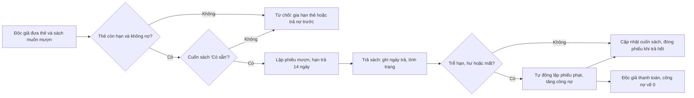
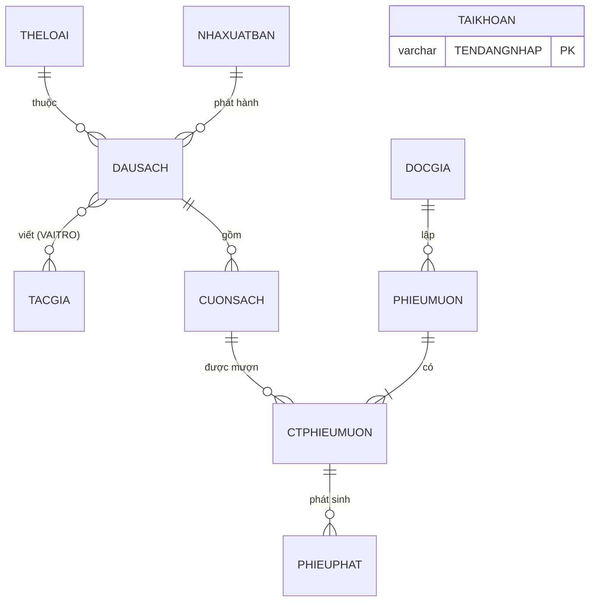

**ĐẠI HỌC QUỐC GIA THÀNH PHỐ HỒ CHÍ MINH** 
**TRƯỜNG ĐẠI HỌC CÔNG NGHỆ THÔNG TIN** 
**KHOA KHOA HỌC VÀ KỸ THUẬT THÔNG TIN** 
\-\-\-\-\-\-\-\-\-

*[Chèn logo trường]*

## BÁO CÁO ĐỒ ÁN QUẢN LÝ THÔNG TIN

# XÂY DỰNG HỆ THỐNG QUẢN LÝ THƯ VIỆN

**Sinh viên thực hiện:**

- [Họ tên SV1] – [MSSV 1] (nhóm trưởng)
- [Họ tên SV2] – [MSSV 2]
- [Họ tên SV3] – [MSSV 3]
- [Họ tên SV4] – [MSSV 4]

**Giảng viên:** ThS. Nguyễn Thành Luân

<i>Thành phố Hồ Chí Minh, tháng 10 năm 2026</i>

---

## BÁO CÁO TÓM TẮT

**1. Tiêu đề báo cáo:** XÂY DỰNG HỆ THỐNG QUẢN LÝ THƯ VIỆN

**2. Danh sách thành viên**

| MSSV | Họ tên | Ghi chú |
|---|---|---|
| [MSSV 1] | [Họ tên SV1] | Nhóm trưởng |
| [MSSV 2] | [Họ tên SV2] | |
| [MSSV 3] | [Họ tên SV3] | |
| [MSSV 4] | [Họ tên SV4] | |

**3. Nội dung chi tiết**

***Nội dung 1: Mô tả bài toán***
+ Bối cảnh thư viện quản lý thủ công và phạm vi hệ thống cần xây dựng.
+ Mục tiêu hệ thống và các nhóm người dùng (quản lý, thủ thư, độc giả).
+ Ba quy trình nghiệp vụ: lập thẻ, mượn sách, trả sách và xử lý phạt.

***Nội dung 2: Phân tích và thiết kế***
+ Danh sách chức năng của hệ thống theo từng phân hệ.
+ 11 thực thể, mối quan hệ, ràng buộc toàn vẹn và sơ đồ ERD.
+ Mô hình logic 11 lược đồ quan hệ kèm tân từ.

***Nội dung 3: Cài đặt***
+ Cài đặt CSDL QUANLYTHUVIEN trên SQL Server 2022 với khóa và ràng buộc CHECK.
+ Dữ liệu mẫu bao quát các tình huống nghiệp vụ (trễ hạn, hư, mất, nợ phạt).

***Nội dung 4: Quản lý thông tin***
+ Xử lý thông tin: 5 stored procedure, 5 trigger, 3 function, 2 cursor.
+ An toàn thông tin: xác thực, phân quyền theo role, import/export, backup/restore.
+ Trình bày thông tin: 5 báo cáo thống kê lấy dữ liệu trực tiếp từ view.

***Nội dung 5: Demo và kết luận***
+ Website demo React + ASP.NET Core gọi trực tiếp các đối tượng trong CSDL.
+ Kết quả đạt được, hạn chế và hướng phát triển.

**4. Phân công công việc**

| MSSV | Họ tên | Nội dung được phân công |
|---|---|---|
| [MSSV 1] | [Họ tên SV1] | Chương 1; Chương 2; mục 5.2 – 5.4 |
| [MSSV 2] | [Họ tên SV2] | Chương 3; mục 4.1.1 – 4.1.2 |
| [MSSV 3] | [Họ tên SV3] | Mục 4.1.3 – 4.1.4; mục 4.2 |
| [MSSV 4] | [Họ tên SV4] | Mục 4.3; mục 5.1, 5.5 |

---

## MỤC LỤC

<!--MUCLUC-->

## DANH MỤC BẢNG

<!--DMBANG-->

## DANH MỤC HÌNH VẼ

<!--DMHINH-->

---

# CHƯƠNG 1: MÔ TẢ BÀI TOÁN

## 1.1. Phát biểu bài toán

Một thư viện quy mô vừa (thư viện trường học hoặc thư viện khu phố) phục vụ vài trăm độc giả với hàng trăm đầu sách. Khi còn ghi chép bằng sổ tay và bảng tính, nhân viên thư viện thường gặp các khó khăn sau:

- Không biết chính xác một cuốn sách cụ thể đang nằm trên kệ, đang được ai mượn hay đã bị hư, mất; số lượng còn lại của mỗi đầu sách phải đếm tay.
- Tiền phạt trả trễ, làm hư hoặc làm mất sách được tính thủ công nên dễ sai và khó đối chiếu; độc giả còn nợ vẫn có thể tiếp tục mượn.
- Việc nhắc độc giả trả sách quá hạn và lập thống kê cuối tháng (sách nào được mượn nhiều, tiền phạt thu được bao nhiêu) tốn nhiều công sức.
- Dữ liệu nằm rải rác trong nhiều tệp, không phân quyền và không được sao lưu định kỳ.

Nhóm xây dựng hệ thống **Quản lý thư viện** gồm CSDL `QUANLYTHUVIEN` trên SQL Server và một website demo. Phạm vi hệ thống: quản lý danh mục (thể loại, tác giả, nhà xuất bản, đầu sách, từng cuốn sách), quản lý độc giả và thẻ thư viện, nghiệp vụ mượn – trả, xử lý tiền phạt, báo cáo thống kê và các chức năng an toàn dữ liệu.

## 1.2. Mục tiêu

- Theo dõi tình trạng của từng cuốn sách; số lượng và số cuốn còn sẵn của mỗi đầu sách luôn được cập nhật tự động.
- Kiểm tra điều kiện mượn ngay tại CSDL: thẻ còn hạn, không còn nợ phạt, cuốn sách đang ở trạng thái "Có sẵn".
- Tự động lập phiếu phạt khi trả sách trễ, hư hoặc mất, và tự động cộng dồn công nợ của độc giả.
- Phân quyền truy cập theo vai trò, mật khẩu được lưu dạng băm, hỗ trợ sao lưu và phục hồi.
- Cung cấp các báo cáo trực quan lấy dữ liệu trực tiếp từ CSDL để hỗ trợ ra quyết định.

## 1.3. Đối tượng sử dụng

- **Quản lý thư viện:** toàn quyền trên dữ liệu, chạy mọi thủ tục, xem tất cả báo cáo và thực hiện sao lưu CSDL. Trên website demo, vai trò này tương ứng với tài khoản quản trị `admin`.
- **Thủ thư:** xem toàn bộ dữ liệu nghiệp vụ, lập thẻ độc giả, lập phiếu mượn, nhận trả sách, thu tiền phạt và gửi nhắc nhở quá hạn; không được xóa dữ liệu và không được xem bảng tài khoản.
- **Độc giả:** chỉ được tra cứu danh mục sách và tình trạng sẵn có; không được xem thông tin của độc giả khác và không được thêm, sửa, xóa.

Ba nhóm này được hiện thực bằng ba role `R_QUANLY`, `R_THUTHU`, `R_DOCGIA` trên SQL Server (mục 4.2).

## 1.4. Quy trình nghiệp vụ thực tế

### 1.4.1. Quy trình lập thẻ độc giả

1. Người đến đăng ký cung cấp họ tên, ngày sinh, giới tính, số điện thoại, địa chỉ và email (nếu có).
2. Thủ thư kiểm tra người đăng ký đủ 16 tuổi tại ngày lập thẻ và email đúng định dạng.
3. Hệ thống cấp mã độc giả; ngày lập thẻ là ngày hiện tại, thẻ có hiệu lực 2 năm.
4. Công nợ ban đầu của độc giả bằng 0; thẻ được in và giao cho độc giả.

### 1.4.2. Quy trình mượn sách

1. Độc giả mang thẻ và những cuốn sách muốn mượn đến quầy.
2. Thủ thư kiểm tra thẻ còn hạn và độc giả không còn nợ tiền phạt; nếu không đạt thì từ chối.
3. Với từng cuốn, kiểm tra cuốn sách đang "Có sẵn" (không đang được mượn, không hư, không mất).
4. Lập phiếu mượn với ngày mượn là hôm nay và hạn trả sau 14 ngày; các cuốn sách chuyển sang trạng thái "Đang mượn".

### 1.4.3. Quy trình trả sách và xử lý phạt

1. Độc giả trả từng cuốn; thủ thư ghi nhận ngày trả và tình trạng khi trả: bình thường, hư hỏng hoặc mất.
2. Cuốn trả bình thường trở về "Có sẵn"; cuốn hư hoặc mất được đánh dấu tương ứng và không cho mượn nữa.
3. Nếu trả trễ, lập phiếu phạt 5.000đ cho mỗi ngày trễ; nếu hư, phạt 50% giá sách; nếu mất, phạt 100% giá sách. Một lần trả có thể phát sinh nhiều phiếu phạt.
4. Khi tất cả các cuốn trong phiếu đã được trả, phiếu mượn chuyển sang "Đã trả".
5. Độc giả thanh toán toàn bộ tiền phạt; công nợ về 0 thì mới được mượn tiếp.

*Hình 1.1: Sơ đồ quy trình mượn – trả sách và xử lý phạt*

# CHƯƠNG 2: PHÂN TÍCH VÀ THIẾT KẾ

## 2.1. Các chức năng của hệ thống

- **Xác thực:** đăng nhập bằng tên đăng nhập và mật khẩu (so khớp giá trị băm), đổi mật khẩu, khóa/mở tài khoản.
- **Quản lý danh mục:** thêm, sửa, xóa và tìm kiếm thể loại, tác giả, nhà xuất bản; quản lý đầu sách kèm danh sách tác giả và vai trò (tác giả, đồng tác giả, dịch giả).
- **Quản lý kho sách:** nhập từng cuốn sách vật lý cho một đầu sách, ghi vị trí kệ, cập nhật tình trạng; số lượng và số cuốn còn sẵn của đầu sách tự cập nhật.
- **Quản lý độc giả:** lập thẻ, sửa thông tin, tìm theo mã hoặc họ tên, xem lịch sử mượn và công nợ hiện tại.
- **Mượn – trả:** lập phiếu mượn nhiều cuốn trong một lần, trả từng cuốn, tự động lập phiếu phạt và thanh toán phạt.
- **Nhắc nhở và xếp loại:** lập danh sách nhắc nhở độc giả giữ sách quá hạn; xếp loại mức độ uy tín của độc giả.
- **Báo cáo:** tình trạng kho, sách được mượn nhiều, lượt mượn theo tháng, tiền phạt theo tháng, độc giả quá hạn.
- **Quản trị CSDL:** phân quyền theo role, import/export dữ liệu, sao lưu và phục hồi.

## 2.2. Các thực thể, thuộc tính và mối quan hệ

*Bảng 2.1: Danh sách thực thể và thuộc tính* (thuộc tính in đậm là khóa chính)

| Thực thể | Ý nghĩa | Thuộc tính chính |
|---|---|---|
| THELOAI | Thể loại sách | **MATL**, TENTL |
| TACGIA | Tác giả, dịch giả | **MATG**, TENTG, NAMSINH, QUOCTICH |
| NHAXUATBAN | Nhà xuất bản | **MANXB**, TENNXB, DIACHI, SODT |
| DAUSACH | Một tựa sách | **MADS**, TENDS, NAMXB, SOTRANG, GIA, SOLUONG, SLCON |
| DAUSACH_TACGIA | Tác giả tham gia đầu sách | **MADS, MATG**, VAITRO |
| CUONSACH | Một cuốn sách vật lý | **MACS**, NGAYNHAP, VITRI, TINHTRANG |
| DOCGIA | Độc giả có thẻ | **MADG**, HOTEN, NGSINH, GIOITINH, SODT, EMAIL, NGAYLAPTHE, NGAYHETHAN, TONGNO |
| PHIEUMUON | Một lần mượn | **MAPM**, NGAYMUON, HANTRA, TINHTRANG |
| CTPHIEUMUON | Cuốn sách trong phiếu | **MAPM, MACS**, NGAYTRA, TINHTRANGTRA |
| PHIEUPHAT | Khoản phạt | **MAPP**, NGAYLAP, LYDO, SOTIEN, DATHANHTOAN |
| TAIKHOAN | Tài khoản đăng nhập web | **TENDANGNHAP**, MATKHAU (băm), TRANGTHAI |

**Mối quan hệ và bản số:**

- Một thể loại có từ 0 đến nhiều đầu sách; mỗi đầu sách thuộc đúng một thể loại. Tương tự, mỗi đầu sách do đúng một nhà xuất bản phát hành.
- Đầu sách và tác giả có quan hệ nhiều – nhiều qua *Viết*, mang thuộc tính VAITRO; một đầu sách có thể chưa ghi nhận tác giả.
- Một đầu sách gồm 0..n cuốn sách; mỗi cuốn thuộc đúng một đầu sách.
- Một độc giả lập 0..n phiếu mượn; mỗi phiếu thuộc đúng một độc giả.
- Phiếu mượn và cuốn sách có quan hệ nhiều – nhiều qua CTPHIEUMUON: một phiếu có ít nhất một cuốn, một cuốn được mượn nhiều lần theo thời gian.
- Mỗi dòng chi tiết mượn phát sinh 0..n phiếu phạt (ví dụ vừa trễ hạn vừa hư hỏng); mỗi phiếu phạt gắn với đúng một dòng chi tiết.
- TAIKHOAN dùng cho việc đăng nhập website, độc lập với các thực thể nghiệp vụ.

## 2.3. Ràng buộc toàn vẹn

*Bảng 2.2: Danh sách ràng buộc toàn vẹn*

| STT | Nội dung | Bối cảnh | Cài đặt |
|---|---|---|---|
| 1 | Giá sách > 0, số trang > 0, năm xuất bản từ 1900 đến năm hiện tại | DAUSACH | CHECK |
| 2 | 0 ≤ SLCON ≤ SOLUONG | DAUSACH | CHECK |
| 3 | Tình trạng cuốn sách thuộc {Có sẵn, Đang mượn, Hư hỏng, Mất} | CUONSACH | CHECK |
| 4 | Ngày hết hạn thẻ sau ngày lập thẻ; độc giả đủ 16 tuổi; email đúng mẫu | DOCGIA | CHECK |
| 5 | Hạn trả sau ngày mượn | PHIEUMUON | CHECK |
| 6 | Đã trả thì phải có tình trạng trả, chưa trả thì cả hai đều rỗng | CTPHIEUMUON | CHECK |
| 7 | Lý do phạt thuộc {Trả trễ, Hư hỏng, Mất sách}, số tiền > 0 | PHIEUPHAT | CHECK |
| 8 | SOLUONG, SLCON bằng số cuốn và số cuốn "Có sẵn" của đầu sách | DAUSACH, CUONSACH | TRG_CUONSACH_CAPNHATSL |
| 9 | Chỉ lập phiếu khi thẻ còn hạn và độc giả không nợ | PHIEUMUON, DOCGIA | TRG_PHIEUMUON_KIEMTRA |
| 10 | Chỉ cho mượn cuốn "Có sẵn"; một cuốn không nằm trong hai phiếu chưa trả | CTPHIEUMUON, CUONSACH | TRG_CTPM_MUONSACH |
| 11 | Trả sách: cập nhật cuốn sách, tự lập phiếu phạt, đóng phiếu khi trả hết | CTPHIEUMUON, PHIEUPHAT | TRG_CTPM_TRASACH |
| 12 | TONGNO bằng tổng tiền phạt chưa thanh toán | DOCGIA, PHIEUPHAT | TRG_PHIEUPHAT_TONGNO |

Các ràng buộc 1–7 có bối cảnh trên một quan hệ nên được cài đặt bằng CHECK. Các ràng buộc 8–12 liên quan đến nhiều quan hệ hoặc là thuộc tính dẫn xuất, nên phải dùng trigger (mục 4.1.2).

## 2.4. Sơ đồ ERD (mức quan niệm)

*Hình 2.1: Sơ đồ ERD của CSDL QUANLYTHUVIEN*

CTPHIEUMUON được vẽ như một thực thể kết hợp vì nó vừa nối phiếu mượn với cuốn sách, vừa là đối tượng phát sinh phiếu phạt.

## 2.5. Mô hình logic và tân từ

Khóa chính được gạch chân, khóa ngoại in nghiêng.

1. THELOAI(<u>MATL</u>, TENTL). Mỗi thể loại có một mã riêng và một tên không trùng với thể loại khác.
2. TACGIA(<u>MATG</u>, TENTG, NAMSINH, QUOCTICH). Mỗi tác giả có mã riêng, họ tên, năm sinh (có thể chưa biết) và quốc tịch.
3. NHAXUATBAN(<u>MANXB</u>, TENNXB, DIACHI, SODT). Mỗi nhà xuất bản có mã riêng, tên không trùng, địa chỉ và số điện thoại.
4. DAUSACH(<u>MADS</u>, TENDS, *MATL*, *MANXB*, NAMXB, SOTRANG, GIA, SOLUONG, SLCON). Đầu sách MADS có tên TENDS, thuộc thể loại MATL, do nhà xuất bản MANXB phát hành năm NAMXB, dày SOTRANG trang, giá bìa GIA; thư viện có SOLUONG cuốn, trong đó SLCON cuốn đang sẵn sàng cho mượn.
5. DAUSACH_TACGIA(<u>*MADS*</u>, <u>*MATG*</u>, VAITRO). Tác giả MATG tham gia đầu sách MADS với vai trò tác giả, đồng tác giả hoặc dịch giả.
6. CUONSACH(<u>MACS</u>, *MADS*, NGAYNHAP, VITRI, TINHTRANG). Cuốn sách MACS là một bản của đầu sách MADS, nhập kho ngày NGAYNHAP, đặt ở VITRI và đang ở tình trạng TINHTRANG.
7. DOCGIA(<u>MADG</u>, HOTEN, NGSINH, GIOITINH, DIACHI, SODT, EMAIL, NGAYLAPTHE, NGAYHETHAN, TONGNO). Độc giả MADG có các thông tin cá nhân, thẻ được lập ngày NGAYLAPTHE và hết hạn ngày NGAYHETHAN; TONGNO là số tiền phạt chưa thanh toán.
8. PHIEUMUON(<u>MAPM</u>, *MADG*, NGAYMUON, HANTRA, TINHTRANG). Độc giả MADG mượn sách theo phiếu MAPM vào ngày NGAYMUON, phải trả trước HANTRA; phiếu "Đang mượn" cho đến khi trả hết thì thành "Đã trả".
9. CTPHIEUMUON(<u>*MAPM*</u>, <u>*MACS*</u>, NGAYTRA, TINHTRANGTRA). Cuốn MACS được mượn theo phiếu MAPM; khi trả thì ghi ngày trả và tình trạng lúc trả.
10. PHIEUPHAT(<u>MAPP</u>, *MAPM*, *MACS*, NGAYLAP, LYDO, SOTIEN, DATHANHTOAN). Phiếu phạt MAPP lập ngày NGAYLAP cho cuốn MACS của phiếu mượn MAPM vì lý do LYDO, số tiền SOTIEN, đã hoặc chưa thanh toán.
11. TAIKHOAN(<u>TENDANGNHAP</u>, MATKHAU, TRANGTHAI). Tài khoản đăng nhập website; MATKHAU là giá trị băm SHA2-256 của mật khẩu, TRANGTHAI bằng 0 nghĩa là tài khoản bị khóa.

# CHƯƠNG 3: CÀI ĐẶT

<!--CH3-->

# CHƯƠNG 4: QUẢN LÝ THÔNG TIN

<!--CH4-->

# CHƯƠNG 5: DEMO VÀ KẾT LUẬN

<!--CH5-->

# TÀI LIỆU THAM KHẢO

<!--TLTK-->
