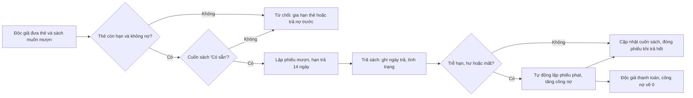
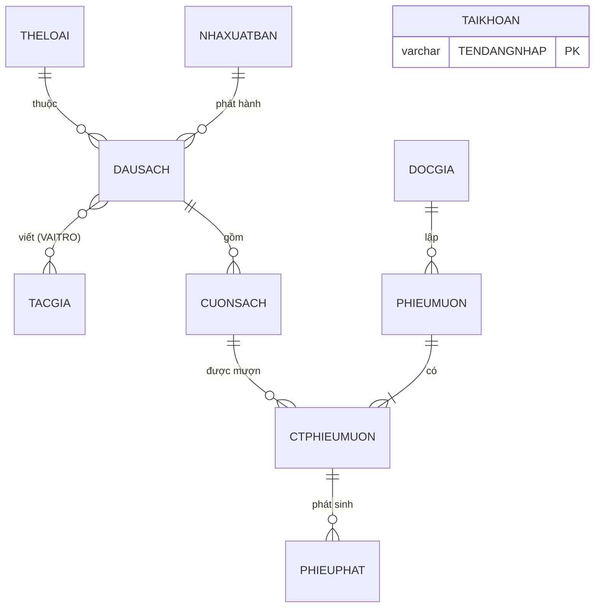

<div align="center">

**ĐẠI HỌC QUỐC GIA THÀNH PHỐ HỒ CHÍ MINH**<br>
**TRƯỜNG ĐẠI HỌC CÔNG NGHỆ THÔNG TIN**<br>
**KHOA KHOA HỌC VÀ KỸ THUẬT THÔNG TIN**<br>
\-\-\-\-\-\-\-\-\-

*[Chèn logo trường]*

## BÁO CÁO ĐỒ ÁN QUẢN LÝ THÔNG TIN

# XÂY DỰNG HỆ THỐNG QUẢN LÝ THƯ VIỆN

</div>

**Sinh viên thực hiện:**

- [Họ tên SV1] – [MSSV 1] (nhóm trưởng)
- [Họ tên SV2] – [MSSV 2]
- [Họ tên SV3] – [MSSV 3]
- [Họ tên SV4] – [MSSV 4]

**Giảng viên:** ThS. Nguyễn Thành Luân

<div align="center"><i>Thành phố Hồ Chí Minh, tháng 10 năm 2026</i></div>

---

## BÁO CÁO TÓM TẮT

**1. Tiêu đề báo cáo:** XÂY DỰNG HỆ THỐNG QUẢN LÝ THƯ VIỆN

**2. Danh sách thành viên**

| MSSV | Họ tên | Ghi chú |
|---|---|---|
| [MSSV 1] | [Họ tên SV1] | Nhóm trưởng |
| [MSSV 2] | [Họ tên SV2] | |
| [MSSV 3] | [Họ tên SV3] | |
| [MSSV 4] | [Họ tên SV4] | |

**3. Nội dung chi tiết**

***Nội dung 1: Mô tả bài toán***
+ Bối cảnh thư viện quản lý thủ công và phạm vi hệ thống cần xây dựng.
+ Mục tiêu hệ thống và các nhóm người dùng (quản lý, thủ thư, độc giả).
+ Ba quy trình nghiệp vụ: lập thẻ, mượn sách, trả sách và xử lý phạt.

***Nội dung 2: Phân tích và thiết kế***
+ Danh sách chức năng của hệ thống theo từng phân hệ.
+ 11 thực thể, mối quan hệ, ràng buộc toàn vẹn và sơ đồ ERD.
+ Mô hình logic 11 lược đồ quan hệ kèm tân từ.

***Nội dung 3: Cài đặt***
+ Cài đặt CSDL QUANLYTHUVIEN trên SQL Server 2022 với khóa và ràng buộc CHECK.
+ Dữ liệu mẫu bao quát các tình huống nghiệp vụ (trễ hạn, hư, mất, nợ phạt).

***Nội dung 4: Quản lý thông tin***
+ Xử lý thông tin: 5 stored procedure, 5 trigger, 3 function, 2 cursor.
+ An toàn thông tin: xác thực, phân quyền theo role, import/export, backup/restore.
+ Trình bày thông tin: 5 báo cáo thống kê lấy dữ liệu trực tiếp từ view.

***Nội dung 5: Demo và kết luận***
+ Website demo React + ASP.NET Core gọi trực tiếp các đối tượng trong CSDL.
+ Kết quả đạt được, hạn chế và hướng phát triển.

**4. Phân công công việc**

| MSSV | Họ tên | Nội dung được phân công |
|---|---|---|
| [MSSV 1] | [Họ tên SV1] | Chương 1; Chương 2; mục 5.2 – 5.4 |
| [MSSV 2] | [Họ tên SV2] | Chương 3; mục 4.1.1 – 4.1.2 |
| [MSSV 3] | [Họ tên SV3] | Mục 4.1.3 – 4.1.4; mục 4.2 |
| [MSSV 4] | [Họ tên SV4] | Mục 4.3; mục 5.1, 5.5 |

---

## MỤC LỤC

- **CHƯƠNG 1: MÔ TẢ BÀI TOÁN**
  - 1.1. Phát biểu bài toán
  - 1.2. Mục tiêu
  - 1.3. Đối tượng sử dụng
  - 1.4. Quy trình nghiệp vụ thực tế
    - 1.4.1. Quy trình lập thẻ độc giả
    - 1.4.2. Quy trình mượn sách
    - 1.4.3. Quy trình trả sách và xử lý phạt
- **CHƯƠNG 2: PHÂN TÍCH VÀ THIẾT KẾ**
  - 2.1. Các chức năng của hệ thống
  - 2.2. Các thực thể, thuộc tính và mối quan hệ
  - 2.3. Ràng buộc toàn vẹn
  - 2.4. Sơ đồ ERD (mức quan niệm)
  - 2.5. Mô hình logic và tân từ
- **CHƯƠNG 3: CÀI ĐẶT**
  - 3.1. Tạo bảng, khóa chính, khóa ngoại và ràng buộc
  - 3.2. Dữ liệu mẫu
- **CHƯƠNG 4: QUẢN LÝ THÔNG TIN**
  - 4.1. Xử lý thông tin
    - 4.1.1. Stored Procedure
    - 4.1.2. Trigger
    - 4.1.3. Function
    - 4.1.4. Cursor
  - 4.2. An toàn thông tin
    - 4.2.1. Xác thực
    - 4.2.2. Phân quyền
    - 4.2.3. Import và Export
    - 4.2.4. Backup và Restore
  - 4.3. Trình bày thông tin (Report)
- **CHƯƠNG 5: DEMO VÀ KẾT LUẬN**
  - 5.1. Website demo
  - 5.2. Kết quả đạt được
  - 5.3. Hạn chế
  - 5.4. Hướng phát triển
  - 5.5. Video demo
- **TÀI LIỆU THAM KHẢO**

## DANH MỤC BẢNG

- Bảng 2.1: Danh sách thực thể và thuộc tính
- Bảng 2.2: Danh sách ràng buộc toàn vẹn
- Bảng 3.1: Số dòng dữ liệu của từng bảng
- Bảng 4.1: Phân quyền theo role

## DANH MỤC HÌNH VẼ

- Hình 1.1: Sơ đồ quy trình mượn – trả sách và xử lý phạt
- Hình 2.1: Sơ đồ ERD của CSDL QUANLYTHUVIEN
- Hình 3.1: Cấu trúc bảng DAUSACH và CTPHIEUMUON
- Hình 3.2: Dữ liệu mẫu bảng DOCGIA và PHIEUMUON
- Hình 4.1: Report tình trạng kho sách
- Hình 4.2: Report đầu sách được mượn nhiều nhất
- Hình 4.3: Report lượt mượn theo tháng
- Hình 4.4: Report tiền phạt theo lý do
- Hình 4.5: Report độc giả giữ sách quá hạn
- Hình 5.1: Các màn hình chính của website demo

---

# CHƯƠNG 1: MÔ TẢ BÀI TOÁN

## 1.1. Phát biểu bài toán

Một thư viện quy mô vừa (thư viện trường học hoặc thư viện khu phố) phục vụ vài trăm độc giả với hàng trăm đầu sách. Khi còn ghi chép bằng sổ tay và bảng tính, nhân viên thư viện thường gặp các khó khăn sau:

- Không biết chính xác một cuốn sách cụ thể đang nằm trên kệ, đang được ai mượn hay đã bị hư, mất; số lượng còn lại của mỗi đầu sách phải đếm tay.
- Tiền phạt trả trễ, làm hư hoặc làm mất sách được tính thủ công nên dễ sai và khó đối chiếu; độc giả còn nợ vẫn có thể tiếp tục mượn.
- Việc nhắc độc giả trả sách quá hạn và lập thống kê cuối tháng (sách nào được mượn nhiều, tiền phạt thu được bao nhiêu) tốn nhiều công sức.
- Dữ liệu nằm rải rác trong nhiều tệp, không phân quyền và không được sao lưu định kỳ.

Nhóm xây dựng hệ thống **Quản lý thư viện** gồm CSDL `QUANLYTHUVIEN` trên SQL Server và một website demo. Phạm vi hệ thống: quản lý danh mục (thể loại, tác giả, nhà xuất bản, đầu sách, từng cuốn sách), quản lý độc giả và thẻ thư viện, nghiệp vụ mượn – trả, xử lý tiền phạt, báo cáo thống kê và các chức năng an toàn dữ liệu.

## 1.2. Mục tiêu

- Theo dõi tình trạng của từng cuốn sách; số lượng và số cuốn còn sẵn của mỗi đầu sách luôn được cập nhật tự động.
- Kiểm tra điều kiện mượn ngay tại CSDL: thẻ còn hạn, không còn nợ phạt, cuốn sách đang ở trạng thái "Có sẵn".
- Tự động lập phiếu phạt khi trả sách trễ, hư hoặc mất, và tự động cộng dồn công nợ của độc giả.
- Phân quyền truy cập theo vai trò, mật khẩu được lưu dạng băm, hỗ trợ sao lưu và phục hồi.
- Cung cấp các báo cáo trực quan lấy dữ liệu trực tiếp từ CSDL để hỗ trợ ra quyết định.

## 1.3. Đối tượng sử dụng

- **Quản lý thư viện:** toàn quyền trên dữ liệu, chạy mọi thủ tục, xem tất cả báo cáo và thực hiện sao lưu CSDL. Trên website demo, vai trò này tương ứng với tài khoản quản trị `admin`.
- **Thủ thư:** xem toàn bộ dữ liệu nghiệp vụ, lập thẻ độc giả, lập phiếu mượn, nhận trả sách, thu tiền phạt và gửi nhắc nhở quá hạn; không được xóa dữ liệu và không được xem bảng tài khoản.
- **Độc giả:** chỉ được tra cứu danh mục sách và tình trạng sẵn có; không được xem thông tin của độc giả khác và không được thêm, sửa, xóa.

Ba nhóm này được hiện thực bằng ba role `R_QUANLY`, `R_THUTHU`, `R_DOCGIA` trên SQL Server (mục 4.2).

## 1.4. Quy trình nghiệp vụ thực tế

### 1.4.1. Quy trình lập thẻ độc giả

1. Người đến đăng ký cung cấp họ tên, ngày sinh, giới tính, số điện thoại, địa chỉ và email (nếu có).
2. Thủ thư kiểm tra người đăng ký đủ 16 tuổi tại ngày lập thẻ và email đúng định dạng.
3. Hệ thống cấp mã độc giả; ngày lập thẻ là ngày hiện tại, thẻ có hiệu lực 2 năm.
4. Công nợ ban đầu của độc giả bằng 0; thẻ được in và giao cho độc giả.

### 1.4.2. Quy trình mượn sách

1. Độc giả mang thẻ và những cuốn sách muốn mượn đến quầy.
2. Thủ thư kiểm tra thẻ còn hạn và độc giả không còn nợ tiền phạt; nếu không đạt thì từ chối.
3. Với từng cuốn, kiểm tra cuốn sách đang "Có sẵn" (không đang được mượn, không hư, không mất).
4. Lập phiếu mượn với ngày mượn là hôm nay và hạn trả sau 14 ngày; các cuốn sách chuyển sang trạng thái "Đang mượn".

### 1.4.3. Quy trình trả sách và xử lý phạt

1. Độc giả trả từng cuốn; thủ thư ghi nhận ngày trả và tình trạng khi trả: bình thường, hư hỏng hoặc mất.
2. Cuốn trả bình thường trở về "Có sẵn"; cuốn hư hoặc mất được đánh dấu tương ứng và không cho mượn nữa.
3. Nếu trả trễ, lập phiếu phạt 5.000đ cho mỗi ngày trễ; nếu hư, phạt 50% giá sách; nếu mất, phạt 100% giá sách. Một lần trả có thể phát sinh nhiều phiếu phạt.
4. Khi tất cả các cuốn trong phiếu đã được trả, phiếu mượn chuyển sang "Đã trả".
5. Độc giả thanh toán toàn bộ tiền phạt; công nợ về 0 thì mới được mượn tiếp.



*Hình 1.1: Sơ đồ quy trình mượn – trả sách và xử lý phạt*

# CHƯƠNG 2: PHÂN TÍCH VÀ THIẾT KẾ

## 2.1. Các chức năng của hệ thống

- **Xác thực:** đăng nhập bằng tên đăng nhập và mật khẩu (so khớp giá trị băm), đổi mật khẩu, khóa/mở tài khoản.
- **Quản lý danh mục:** thêm, sửa, xóa và tìm kiếm thể loại, tác giả, nhà xuất bản; quản lý đầu sách kèm danh sách tác giả và vai trò (tác giả, đồng tác giả, dịch giả).
- **Quản lý kho sách:** nhập từng cuốn sách vật lý cho một đầu sách, ghi vị trí kệ, cập nhật tình trạng; số lượng và số cuốn còn sẵn của đầu sách tự cập nhật.
- **Quản lý độc giả:** lập thẻ, sửa thông tin, tìm theo mã hoặc họ tên, xem lịch sử mượn và công nợ hiện tại.
- **Mượn – trả:** lập phiếu mượn nhiều cuốn trong một lần, trả từng cuốn, tự động lập phiếu phạt và thanh toán phạt.
- **Nhắc nhở và xếp loại:** lập danh sách nhắc nhở độc giả giữ sách quá hạn; xếp loại mức độ uy tín của độc giả.
- **Báo cáo:** tình trạng kho, sách được mượn nhiều, lượt mượn theo tháng, tiền phạt theo tháng, độc giả quá hạn.
- **Quản trị CSDL:** phân quyền theo role, import/export dữ liệu, sao lưu và phục hồi.

## 2.2. Các thực thể, thuộc tính và mối quan hệ

*Bảng 2.1: Danh sách thực thể và thuộc tính* (thuộc tính in đậm là khóa chính)

| Thực thể | Ý nghĩa | Thuộc tính chính |
|---|---|---|
| THELOAI | Thể loại sách | **MATL**, TENTL |
| TACGIA | Tác giả, dịch giả | **MATG**, TENTG, NAMSINH, QUOCTICH |
| NHAXUATBAN | Nhà xuất bản | **MANXB**, TENNXB, DIACHI, SODT |
| DAUSACH | Một tựa sách | **MADS**, TENDS, NAMXB, SOTRANG, GIA, SOLUONG, SLCON |
| DAUSACH_TACGIA | Tác giả tham gia đầu sách | **MADS, MATG**, VAITRO |
| CUONSACH | Một cuốn sách vật lý | **MACS**, NGAYNHAP, VITRI, TINHTRANG |
| DOCGIA | Độc giả có thẻ | **MADG**, HOTEN, NGSINH, GIOITINH, SODT, EMAIL, NGAYLAPTHE, NGAYHETHAN, TONGNO |
| PHIEUMUON | Một lần mượn | **MAPM**, NGAYMUON, HANTRA, TINHTRANG |
| CTPHIEUMUON | Cuốn sách trong phiếu | **MAPM, MACS**, NGAYTRA, TINHTRANGTRA |
| PHIEUPHAT | Khoản phạt | **MAPP**, NGAYLAP, LYDO, SOTIEN, DATHANHTOAN |
| TAIKHOAN | Tài khoản đăng nhập web | **TENDANGNHAP**, MATKHAU (băm), TRANGTHAI |

**Mối quan hệ và bản số:**

- Một thể loại có từ 0 đến nhiều đầu sách; mỗi đầu sách thuộc đúng một thể loại. Tương tự, mỗi đầu sách do đúng một nhà xuất bản phát hành.
- Đầu sách và tác giả có quan hệ nhiều – nhiều qua *Viết*, mang thuộc tính VAITRO; một đầu sách có thể chưa ghi nhận tác giả.
- Một đầu sách gồm 0..n cuốn sách; mỗi cuốn thuộc đúng một đầu sách.
- Một độc giả lập 0..n phiếu mượn; mỗi phiếu thuộc đúng một độc giả.
- Phiếu mượn và cuốn sách có quan hệ nhiều – nhiều qua CTPHIEUMUON: một phiếu có ít nhất một cuốn, một cuốn được mượn nhiều lần theo thời gian.
- Mỗi dòng chi tiết mượn phát sinh 0..n phiếu phạt (ví dụ vừa trễ hạn vừa hư hỏng); mỗi phiếu phạt gắn với đúng một dòng chi tiết.
- TAIKHOAN dùng cho việc đăng nhập website, độc lập với các thực thể nghiệp vụ.

## 2.3. Ràng buộc toàn vẹn

*Bảng 2.2: Danh sách ràng buộc toàn vẹn*

| STT | Nội dung | Bối cảnh | Cài đặt |
|---|---|---|---|
| 1 | Giá sách > 0, số trang > 0, năm xuất bản từ 1900 đến năm hiện tại | DAUSACH | CHECK |
| 2 | 0 ≤ SLCON ≤ SOLUONG | DAUSACH | CHECK |
| 3 | Tình trạng cuốn sách thuộc {Có sẵn, Đang mượn, Hư hỏng, Mất} | CUONSACH | CHECK |
| 4 | Ngày hết hạn thẻ sau ngày lập thẻ; độc giả đủ 16 tuổi; email đúng mẫu | DOCGIA | CHECK |
| 5 | Hạn trả sau ngày mượn | PHIEUMUON | CHECK |
| 6 | Đã trả thì phải có tình trạng trả, chưa trả thì cả hai đều rỗng | CTPHIEUMUON | CHECK |
| 7 | Lý do phạt thuộc {Trả trễ, Hư hỏng, Mất sách}, số tiền > 0 | PHIEUPHAT | CHECK |
| 8 | SOLUONG, SLCON bằng số cuốn và số cuốn "Có sẵn" của đầu sách | DAUSACH, CUONSACH | TRG_CUONSACH_CAPNHATSL |
| 9 | Chỉ lập phiếu khi thẻ còn hạn và độc giả không nợ | PHIEUMUON, DOCGIA | TRG_PHIEUMUON_KIEMTRA |
| 10 | Chỉ cho mượn cuốn "Có sẵn"; một cuốn không nằm trong hai phiếu chưa trả | CTPHIEUMUON, CUONSACH | TRG_CTPM_MUONSACH |
| 11 | Trả sách: cập nhật cuốn sách, tự lập phiếu phạt, đóng phiếu khi trả hết | CTPHIEUMUON, PHIEUPHAT | TRG_CTPM_TRASACH |
| 12 | TONGNO bằng tổng tiền phạt chưa thanh toán | DOCGIA, PHIEUPHAT | TRG_PHIEUPHAT_TONGNO |

Các ràng buộc 1–7 có bối cảnh trên một quan hệ nên được cài đặt bằng CHECK. Các ràng buộc 8–12 liên quan đến nhiều quan hệ hoặc là thuộc tính dẫn xuất, nên phải dùng trigger (mục 4.1.2).

## 2.4. Sơ đồ ERD (mức quan niệm)



*Hình 2.1: Sơ đồ ERD của CSDL QUANLYTHUVIEN*

CTPHIEUMUON được vẽ như một thực thể kết hợp vì nó vừa nối phiếu mượn với cuốn sách, vừa là đối tượng phát sinh phiếu phạt.

## 2.5. Mô hình logic và tân từ

Khóa chính được gạch chân, khóa ngoại in nghiêng.

1. THELOAI(<u>MATL</u>, TENTL). Mỗi thể loại có một mã riêng và một tên không trùng với thể loại khác.
2. TACGIA(<u>MATG</u>, TENTG, NAMSINH, QUOCTICH). Mỗi tác giả có mã riêng, họ tên, năm sinh (có thể chưa biết) và quốc tịch.
3. NHAXUATBAN(<u>MANXB</u>, TENNXB, DIACHI, SODT). Mỗi nhà xuất bản có mã riêng, tên không trùng, địa chỉ và số điện thoại.
4. DAUSACH(<u>MADS</u>, TENDS, *MATL*, *MANXB*, NAMXB, SOTRANG, GIA, SOLUONG, SLCON). Đầu sách MADS có tên TENDS, thuộc thể loại MATL, do nhà xuất bản MANXB phát hành năm NAMXB, dày SOTRANG trang, giá bìa GIA; thư viện có SOLUONG cuốn, trong đó SLCON cuốn đang sẵn sàng cho mượn.
5. DAUSACH_TACGIA(<u>*MADS*</u>, <u>*MATG*</u>, VAITRO). Tác giả MATG tham gia đầu sách MADS với vai trò tác giả, đồng tác giả hoặc dịch giả.
6. CUONSACH(<u>MACS</u>, *MADS*, NGAYNHAP, VITRI, TINHTRANG). Cuốn sách MACS là một bản của đầu sách MADS, nhập kho ngày NGAYNHAP, đặt ở VITRI và đang ở tình trạng TINHTRANG.
7. DOCGIA(<u>MADG</u>, HOTEN, NGSINH, GIOITINH, DIACHI, SODT, EMAIL, NGAYLAPTHE, NGAYHETHAN, TONGNO). Độc giả MADG có các thông tin cá nhân, thẻ được lập ngày NGAYLAPTHE và hết hạn ngày NGAYHETHAN; TONGNO là số tiền phạt chưa thanh toán.
8. PHIEUMUON(<u>MAPM</u>, *MADG*, NGAYMUON, HANTRA, TINHTRANG). Độc giả MADG mượn sách theo phiếu MAPM vào ngày NGAYMUON, phải trả trước HANTRA; phiếu "Đang mượn" cho đến khi trả hết thì thành "Đã trả".
9. CTPHIEUMUON(<u>*MAPM*</u>, <u>*MACS*</u>, NGAYTRA, TINHTRANGTRA). Cuốn MACS được mượn theo phiếu MAPM; khi trả thì ghi ngày trả và tình trạng lúc trả.
10. PHIEUPHAT(<u>MAPP</u>, *MAPM*, *MACS*, NGAYLAP, LYDO, SOTIEN, DATHANHTOAN). Phiếu phạt MAPP lập ngày NGAYLAP cho cuốn MACS của phiếu mượn MAPM vì lý do LYDO, số tiền SOTIEN, đã hoặc chưa thanh toán.
11. TAIKHOAN(<u>TENDANGNHAP</u>, MATKHAU, TRANGTHAI). Tài khoản đăng nhập website; MATKHAU là giá trị băm SHA2-256 của mật khẩu, TRANGTHAI bằng 0 nghĩa là tài khoản bị khóa.

# CHƯƠNG 3: CÀI ĐẶT

## 3.1. Tạo bảng, khóa chính, khóa ngoại và ràng buộc

CSDL được cài đặt trên **Microsoft SQL Server 2022**, chạy trong Docker (image `mssql/server:2022-latest`), với collation `Vietnamese_CI_AS` để sắp xếp và so sánh đúng tiếng Việt.  Toàn bộ script được chia thành các tệp theo yêu cầu đồ án: `1_TaoBang.sql` (11 bảng), `2_DuLieuMau.sql`, `3_Function.sql`, `4_Trigger.sql`, `5_StoredProcedure.sql`, `6_Cursor.sql`, `7_AnToanThongTin.sql` và `8_Report.sql`. Chạy lại tệp 1 sẽ xóa và tạo lại toàn bộ CSDL. Hai câu lệnh tiêu biểu:

```sql
CREATE TABLE DAUSACH (
  MADS    CHAR(5)       PRIMARY KEY,
  TENDS   NVARCHAR(100) NOT NULL,
  MATL    CHAR(4) NOT NULL FOREIGN KEY REFERENCES THELOAI (MATL),
  MANXB   CHAR(5) NOT NULL FOREIGN KEY REFERENCES NHAXUATBAN (MANXB),
  NAMXB   INT NOT NULL,  SOTRANG INT NOT NULL,  GIA MONEY NOT NULL,
  SOLUONG INT NOT NULL DEFAULT 0,  SLCON INT NOT NULL DEFAULT 0,
  CONSTRAINT CK_DAUSACH_NAMXB CHECK (NAMXB BETWEEN 1900 AND YEAR(GETDATE())),
  CONSTRAINT CK_DAUSACH_GIA   CHECK (GIA > 0),
  CONSTRAINT CK_DAUSACH_SL    CHECK (SOLUONG >= 0
                              AND SLCON BETWEEN 0 AND SOLUONG))

CREATE TABLE CTPHIEUMUON (
  MAPM CHAR(6) FOREIGN KEY REFERENCES PHIEUMUON (MAPM),
  MACS CHAR(5) FOREIGN KEY REFERENCES CUONSACH (MACS),
  NGAYTRA DATE NULL,  TINHTRANGTRA NVARCHAR(20) NULL,
  PRIMARY KEY (MAPM, MACS),
  CONSTRAINT CK_CTPM_TINHTRANGTRA CHECK (TINHTRANGTRA IN
             (N'Bình thường', N'Hư hỏng', N'Mất')),
  CONSTRAINT CK_CTPM_TRASACH CHECK ((NGAYTRA IS NULL AND TINHTRANGTRA IS NULL)
             OR (NGAYTRA IS NOT NULL AND TINHTRANGTRA IS NOT NULL)))
```

Khóa chính gồm nhiều cột (`CTPHIEUMUON`, `DAUSACH_TACGIA`) được khai báo bằng mệnh đề `PRIMARY KEY (...)`. `PHIEUPHAT` dùng khóa ngoại kép `(MAPM, MACS)` tham chiếu đến `CTPHIEUMUON`. Mật khẩu trong `TAIKHOAN` có kiểu `VARBINARY(32)` để chứa giá trị băm SHA2-256.

> *[Chèn ảnh chụp cấu trúc bảng DAUSACH và CTPHIEUMUON trong SSMS / Object Explorer]*

*Hình 3.1: Cấu trúc bảng DAUSACH và CTPHIEUMUON*

## 3.2. Dữ liệu mẫu

Dữ liệu mẫu mô phỏng hoạt động của thư viện từ tháng 4 đến tháng 9/2026. Bảng dưới đây là số dòng thực tế của từng bảng tại thời điểm chụp CSDL (ngày 11/10/2026).

*Bảng 3.1: Số dòng dữ liệu của từng bảng*

| **Bảng** | **Dòng** | **Bảng** | **Dòng** | **Bảng** | **Dòng** |
|---|---|---|---|---|---|
| THELOAI | 9 | CUONSACH | 26 | CTPHIEUMUON | 38 |
| TACGIA | 16 | DOCGIA | 118 | PHIEUPHAT | 10 |
| NHAXUATBAN | 10 | PHIEUMUON | 23 | TAIKHOAN | 1 |
| DAUSACH | 16 | DAUSACH_TACGIA | 17 |  |  |

Dữ liệu được chọn để bao phủ các tình huống nghiệp vụ và các giá trị biên:

- **Độc giả:** thẻ đã hết hạn (DG006, hết hạn 31/08/2026); đang nợ phạt (DG009 nợ 250.000đ do làm mất sách); chưa từng mượn (DG012); không có email (DG013, DG015) hoặc không có địa chỉ (DG015).
- **Sách:** cuốn bị hư (CS006, CS012), cuốn bị mất (CS015); đầu sách chưa có tác giả (DS016); thể loại chưa có sách (TL08); tác giả không rõ năm sinh (TG010); nhà xuất bản thiếu địa chỉ (NXB10).
- **Mượn – trả:** phiếu trả đúng hạn, trả trễ, trả một phần (PM0012, PM0016), phiếu đang quá hạn; phiếu phạt đủ ba lý do, có phiếu đã và chưa thanh toán.

> *[Chèn ảnh chụp dữ liệu mẫu bảng DOCGIA và PHIEUMUON]*

*Hình 3.2: Dữ liệu mẫu bảng DOCGIA và PHIEUMUON*

# CHƯƠNG 4: QUẢN LÝ THÔNG TIN

## 4.1. Xử lý thông tin

Tất cả kết quả trong chương này được chạy trên **bản sao** `QUANLYTHUVIEN_BAOCAO` của CSDL vào ngày 11/10/2026, nên các giá trị phụ thuộc ngày hiện tại (số ngày trễ, hạn trả, hạn thẻ) được tính theo ngày này. Script và kết quả đầy đủ nằm trong thư mục `docs/baocao/ketqua/`.

### 4.1.1. Stored Procedure

**Procedure 1:** SP_THEMDOCGIA (tham số vào)

**Bài toán:** Lập thẻ cho độc giả mới. Nếu mã độc giả đã tồn tại thì trả về 0; ngược lại thêm độc giả với ngày lập thẻ là hôm nay, thẻ có hạn 2 năm, và trả về 2.

**Code:**

```sql
CREATE OR ALTER PROCEDURE SP_THEMDOCGIA @MADG CHAR(5), @HOTEN NVARCHAR(40),
  @NGSINH DATE, @GIOITINH NVARCHAR(3), @DIACHI NVARCHAR(100),
  @SODT VARCHAR(15), @EMAIL VARCHAR(50)
AS BEGIN
  IF EXISTS (SELECT * FROM DOCGIA WHERE MADG = @MADG)
  BEGIN PRINT N'Mã độc giả đã tồn tại.'; RETURN 0; END
  DECLARE @NGAYLAP DATE = GETDATE();
  INSERT INTO DOCGIA (MADG, HOTEN, NGSINH, GIOITINH, DIACHI, SODT, EMAIL,
                      NGAYLAPTHE, NGAYHETHAN)
  VALUES (@MADG, @HOTEN, @NGSINH, @GIOITINH, @DIACHI, @SODT, @EMAIL,
          @NGAYLAP, DATEADD(YEAR, 2, @NGAYLAP));
  RETURN 2;
END
```

**Kết quả:** Gọi `EXEC @kq = SP_THEMDOCGIA 'DG999', N'Trần Thị Mai', '2004-03-15', ...` hai lần liên tiếp.

| **Trước** | **Sau** |
|---|---|
| Số độc giả: 118 | Số độc giả: 119; lần 1 trả về 2, lần 2 trả về 0 ("Mã độc giả đã tồn tại.") |
|  | DG999 – Trần Thị Mai, lập thẻ 2026-10-11, hết hạn 2028-10-11, TONGNO = 0 |

> *[Chèn ảnh chụp trước và sau khi chạy SP_THEMDOCGIA]*

**Giải thích:** Thủ tục kiểm tra trùng khóa trước khi thêm để trả mã lỗi rõ ràng thay vì để SQL Server báo lỗi vi phạm khóa chính. Ngày hết hạn được tính bằng `DATEADD`. Ràng buộc tuổi và email vẫn do CHECK của bảng `DOCGIA` kiểm tra.

**Procedure 2:** SP_LAPPHIEUMUON (tham số vào và ra)

**Bài toán:** Lập phiếu mượn cho một độc giả với danh sách mã cuốn sách cách nhau bởi dấu phẩy. Mã phiếu tự tăng và được trả ra qua tham số OUTPUT; hạn trả là 14 ngày. Nếu một cuốn bất kỳ không hợp lệ thì hủy toàn bộ phiếu.

**Code:**

```sql
CREATE OR ALTER PROCEDURE SP_LAPPHIEUMUON
  @MADG CHAR(5), @DSMACS VARCHAR(200), @MAPM CHAR(6) OUTPUT
AS BEGIN
  ...  -- kiem tra doc gia ton tai va danh sach khong rong
  BEGIN TRY
    BEGIN TRANSACTION;
    SELECT @MAX = ISNULL(MAX(CAST(SUBSTRING(MAPM, 3, 4) AS INT)), 0)
    FROM PHIEUMUON WITH (UPDLOCK, HOLDLOCK);
    SET @MAPM = 'PM' + RIGHT('0000' + CAST(@MAX + 1 AS VARCHAR(4)), 4);
    INSERT INTO PHIEUMUON (MAPM, MADG, NGAYMUON, HANTRA, TINHTRANG)
    VALUES (@MAPM, @MADG, CAST(GETDATE() AS DATE),
            DATEADD(DAY, 14, CAST(GETDATE() AS DATE)), N'Đang mượn');
    INSERT INTO CTPHIEUMUON (MAPM, MACS)
    SELECT DISTINCT @MAPM, LTRIM(RTRIM(value))
    FROM STRING_SPLIT(@DSMACS, ',') WHERE LTRIM(RTRIM(value)) <> '';
    COMMIT TRANSACTION; RETURN 1;
  END TRY
  BEGIN CATCH
    IF @@TRANCOUNT > 0 ROLLBACK;
    SET @MAPM = NULL; RAISERROR(...); RETURN 0;
  END CATCH
END
```

**Kết quả:** Độc giả DG012 (chưa từng mượn, không nợ) mượn hai cuốn CS001 và CS002 của đầu sách DS001 "Mắt biếc".

| **Trước** | **Sau** |
|---|---|
| CS001, CS002: Có sẵn; DS001.SLCON = 2 | Trả về 1, @MAPM = PM0329; phiếu ngày mượn 2026-10-11, hạn 2026-10-25 |
|  | CS001, CS002: Đang mượn; DS001.SLCON = 0 |

> *[Chèn ảnh chụp trước và sau khi chạy SP_LAPPHIEUMUON]*

**Giải thích:** Toàn bộ thao tác nằm trong một transaction: lỗi ở bất kỳ cuốn nào (do trigger chặn) sẽ rollback cả phiếu. `UPDLOCK, HOLDLOCK` ngăn hai người lập phiếu cùng lúc sinh trùng mã. Việc kiểm tra thẻ, công nợ và tình trạng sách được giao cho trigger (mục 4.1.2), nên tình trạng cuốn sách và SLCON tự đổi theo.

**Procedure 3:** SP_TRASACH (tham số vào và ra)

**Bài toán:** Ghi nhận trả một cuốn sách của một phiếu với tình trạng khi trả, và trả ra tổng tiền phạt phát sinh. Trả về 0 nếu không tìm thấy, 1 nếu sách đã được trả trước đó, 2 nếu thành công.

**Code:**

```sql
CREATE OR ALTER PROCEDURE SP_TRASACH @MAPM CHAR(6), @MACS CHAR(5),
  @TINHTRANGTRA NVARCHAR(20) = N'Bình thường', @TIENPHAT MONEY OUTPUT
AS BEGIN
  SET @TIENPHAT = 0;
  IF NOT EXISTS (SELECT * FROM CTPHIEUMUON WHERE MAPM = @MAPM AND MACS = @MACS)
    RETURN 0;
  IF EXISTS (SELECT * FROM CTPHIEUMUON WHERE MAPM = @MAPM AND MACS = @MACS
             AND NGAYTRA IS NOT NULL) RETURN 1;
  UPDATE CTPHIEUMUON SET NGAYTRA = CAST(GETDATE() AS DATE),
         TINHTRANGTRA = @TINHTRANGTRA
  WHERE MAPM = @MAPM AND MACS = @MACS;
  SELECT @TIENPHAT = ISNULL(SUM(SOTIEN), 0) FROM PHIEUPHAT
  WHERE MAPM = @MAPM AND MACS = @MACS AND DATHANHTOAN = 0;
  RETURN 2;
END
```

**Kết quả:** Trả cuốn CS011 của phiếu PM0011 (độc giả DG001, hạn trả 2026-09-15) với tình trạng bình thường.

| **Trước** | **Sau** |
|---|---|
| CS011: Đang mượn, chưa trả | Trả về 2, @TIENPHAT = 130.000; CS011: Có sẵn; PM0011: Đã trả |
| DG001.TONGNO = 0 | Phiếu phạt PP0011 "Trả trễ" 130.000đ; DG001.TONGNO = 130.000 |

> *[Chèn ảnh chụp trước và sau khi chạy SP_TRASACH]*

**Giải thích:** Thủ tục chỉ cập nhật ngày trả và tình trạng; việc đổi trạng thái cuốn sách, lập phiếu phạt (26 ngày × 5.000đ) và đóng phiếu do trigger `TRG_CTPM_TRASACH` đảm nhận. Sau đó thủ tục đọc lại bảng PHIEUPHAT để trả về số tiền phạt cho giao diện.

**Procedure 4:** SP_THANHTOANPHAT (tham số vào và ra)

**Bài toán:** Thanh toán toàn bộ tiền phạt chưa trả của một độc giả, trả ra số tiền đã thu. Trả về 0 nếu độc giả không tồn tại, 1 nếu không có khoản nợ, 2 nếu thành công.

**Code:**

```sql
CREATE OR ALTER PROCEDURE SP_THANHTOANPHAT @MADG CHAR(5), @SOTIEN MONEY OUTPUT
AS BEGIN
  SET @SOTIEN = 0;
  IF NOT EXISTS (SELECT * FROM DOCGIA WHERE MADG = @MADG) RETURN 0;
  SELECT @SOTIEN = ISNULL(SUM(PP.SOTIEN), 0)
  FROM PHIEUPHAT PP JOIN PHIEUMUON PM ON PP.MAPM = PM.MAPM
  WHERE PM.MADG = @MADG AND PP.DATHANHTOAN = 0;
  IF @SOTIEN = 0 RETURN 1;
  UPDATE PHIEUPHAT SET DATHANHTOAN = 1
  WHERE DATHANHTOAN = 0
    AND MAPM IN (SELECT MAPM FROM PHIEUMUON WHERE MADG = @MADG);
  RETURN 2;
END
```

**Kết quả:** Độc giả DG010 có phiếu phạt PP0008 (15.000đ) chưa thanh toán.

| **Trước** | **Sau** |
|---|---|
| PP0008: DATHANHTOAN = 0 | Lần 1: trả về 2, @SOTIEN = 15.000; PP0008: DATHANHTOAN = 1 |
| DG010.TONGNO = 15.000 | DG010.TONGNO = 0; lần 2: trả về 1 (không còn khoản nợ) |

> *[Chèn ảnh chụp trước và sau khi chạy SP_THANHTOANPHAT]*

**Giải thích:** Số tiền được tính trước khi cập nhật để trả ra đúng số đã thu. Thủ tục không tự sửa TONGNO mà để trigger `TRG_PHIEUPHAT_TONGNO` tính lại, nên công nợ luôn khớp với các phiếu phạt.

**Procedure 5:** SP_THONGKETHANG (tham số vào và ra)

**Bài toán:** Thống kê hoạt động của một tháng: trả ra số phiếu mượn, số lượt sách được mượn, tổng tiền phạt phát sinh; đồng thời trả về bảng 5 đầu sách được mượn nhiều nhất trong tháng.

**Code:**

```sql
CREATE OR ALTER PROCEDURE SP_THONGKETHANG @THANG INT, @NAM INT,
  @SOPHIEU INT OUTPUT, @SOLUOTSACH INT OUTPUT, @TIENPHAT MONEY OUTPUT
AS BEGIN
  SELECT @SOPHIEU = COUNT(*) FROM PHIEUMUON
  WHERE MONTH(NGAYMUON) = @THANG AND YEAR(NGAYMUON) = @NAM;
  SELECT @SOLUOTSACH = COUNT(*) FROM CTPHIEUMUON CT
    JOIN PHIEUMUON PM ON CT.MAPM = PM.MAPM
  WHERE MONTH(PM.NGAYMUON) = @THANG AND YEAR(PM.NGAYMUON) = @NAM;
  SELECT @TIENPHAT = ISNULL(SUM(SOTIEN), 0) FROM PHIEUPHAT
  WHERE MONTH(NGAYLAP) = @THANG AND YEAR(NGAYLAP) = @NAM;
  SELECT TOP 5 DS.MADS, DS.TENDS, COUNT(*) AS SOLUOTMUON
  FROM CTPHIEUMUON CT JOIN PHIEUMUON PM ON CT.MAPM = PM.MAPM
    JOIN CUONSACH CS ON CT.MACS = CS.MACS JOIN DAUSACH DS ON CS.MADS = DS.MADS
  WHERE MONTH(PM.NGAYMUON) = @THANG AND YEAR(PM.NGAYMUON) = @NAM
  GROUP BY DS.MADS, DS.TENDS ORDER BY SOLUOTMUON DESC, DS.MADS;
END
```

**Kết quả:** `EXEC SP_THONGKETHANG 9, 2026, ...`: @SOPHIEU = 6, @SOLUOTSACH = 11, @TIENPHAT = 0. Top 5: Clean Code (2 lượt), Mắt biếc, Dế Mèn phiêu lưu ký, Nhà giả kim, Đắc nhân tâm (1 lượt mỗi đầu sách).

> *[Chèn ảnh chụp kết quả SP_THONGKETHANG tháng 9/2026]*

**Giải thích:** Thủ tục kết hợp hai cách trả kết quả: ba chỉ số tổng hợp qua tham số OUTPUT và một bảng chi tiết qua câu SELECT. Tiền phạt tháng 9 bằng 0 vì các phiếu phạt trong dữ liệu mẫu được lập từ tháng 6 đến tháng 8/2026.

### 4.1.2. Trigger

**Trigger 1:** TRG_CUONSACH_CAPNHATSL (AFTER INSERT, UPDATE, DELETE trên CUONSACH)

**Bài toán:** Giữ cho hai thuộc tính dẫn xuất DAUSACH.SOLUONG (tổng số cuốn) và DAUSACH.SLCON (số cuốn "Có sẵn") luôn đúng mỗi khi thêm, xóa cuốn sách hoặc đổi tình trạng của nó. Tầm ảnh hưởng: CUONSACH (thêm +, xóa +, sửa MADS, TINHTRANG +).

**Code:**

```sql
CREATE TRIGGER TRG_CUONSACH_CAPNHATSL ON CUONSACH
AFTER INSERT, UPDATE, DELETE AS
BEGIN
  UPDATE DAUSACH
  SET SOLUONG = (SELECT COUNT(*) FROM CUONSACH CS WHERE CS.MADS = DAUSACH.MADS),
      SLCON   = (SELECT COUNT(*) FROM CUONSACH CS WHERE CS.MADS = DAUSACH.MADS
                 AND CS.TINHTRANG = N'Có sẵn')
  WHERE MADS IN (SELECT MADS FROM inserted UNION SELECT MADS FROM deleted)
END
```

**Kết quả:** Đầu sách DS009 "Clean Code": ban đầu SOLUONG = 2, SLCON = 0. Thêm cuốn CS999 ⇒ 3 / 1. Đổi CS999 sang "Hư hỏng" ⇒ 3 / 0.

> *[Chèn ảnh chụp SOLUONG, SLCON của DS009 trước và sau khi thêm/sửa CS999]*

**Giải thích:** Trigger tính lại từ đầu thay vì cộng trừ, nên vẫn đúng khi một lệnh tác động nhiều dòng hoặc chuyển cuốn sách sang đầu sách khác. Hợp `inserted` và `deleted` giúp xử lý chung cả ba thao tác.

**Trigger 2:** TRG_PHIEUMUON_KIEMTRA (AFTER INSERT, UPDATE trên PHIEUMUON)

**Bài toán:** Chỉ cho lập phiếu mượn khi thẻ độc giả còn hạn tại ngày mượn và độc giả không còn nợ phạt. Tầm ảnh hưởng: PHIEUMUON (thêm +, sửa MADG, NGAYMUON, HANTRA +).

**Code:**

```sql
CREATE TRIGGER TRG_PHIEUMUON_KIEMTRA ON PHIEUMUON AFTER INSERT, UPDATE AS
BEGIN
  IF NOT (UPDATE(MADG) OR UPDATE(NGAYMUON) OR UPDATE(HANTRA)) RETURN
  IF EXISTS (SELECT * FROM inserted I JOIN DOCGIA DG ON I.MADG = DG.MADG
             WHERE I.NGAYMUON > DG.NGAYHETHAN)
  BEGIN RAISERROR(N'Thẻ độc giả đã hết hạn, không thể lập phiếu mượn.',16,1)
        ROLLBACK TRANSACTION RETURN END
  IF EXISTS (SELECT * FROM inserted I JOIN DOCGIA DG ON I.MADG = DG.MADG
             WHERE DG.TONGNO > 0)
  BEGIN RAISERROR(N'Độc giả còn nợ tiền phạt, phải thanh toán trước
                  khi mượn.',16,1)
        ROLLBACK TRANSACTION RETURN END
END
```

**Kết quả:** Thử lập phiếu cho DG006 (thẻ hết hạn 2026-08-31) và DG009 (TONGNO = 250.000): cả hai bị từ chối với đúng thông báo trên, không có phiếu nào được tạo.

> *[Chèn ảnh chụp thông báo lỗi khi lập phiếu cho DG006 và DG009]*

**Giải thích:** `IF UPDATE(...)` giúp bỏ qua kiểm tra khi chỉ cập nhật cột TINHTRANG của phiếu (lúc trả sách). Ràng buộc chỉ áp dụng tại thời điểm lập phiếu, không áp dụng hồi tố cho các phiếu cũ.

**Trigger 3:** TRG_CTPM_MUONSACH (AFTER INSERT trên CTPHIEUMUON)

**Bài toán:** Khi thêm sách vào phiếu: cuốn sách phải "Có sẵn", không nằm trong hai phiếu chưa trả, phiếu phải đang mở; nếu hợp lệ thì chuyển cuốn sách sang "Đang mượn". Tầm ảnh hưởng: CTPHIEUMUON (thêm +), CUONSACH (sửa TINHTRANG).

**Code:**

```sql
CREATE TRIGGER TRG_CTPM_MUONSACH ON CTPHIEUMUON AFTER INSERT AS
BEGIN
  IF EXISTS (SELECT * FROM inserted I JOIN CUONSACH CS ON I.MACS = CS.MACS
             WHERE I.NGAYTRA IS NULL AND CS.TINHTRANG <> N'Có sẵn')
  BEGIN RAISERROR(N'Có cuốn sách không ở tình trạng "Có sẵn", ...', 16, 1)
        ROLLBACK TRANSACTION RETURN END
  ...  -- kiem tra trung phieu chua tra, phieu da dong
  UPDATE CUONSACH SET TINHTRANG = N'Đang mượn'
  WHERE MACS IN (SELECT MACS FROM inserted WHERE NGAYTRA IS NULL)
END
```

**Kết quả:** Thêm CS015 (Mất) vào phiếu PM0329 và thêm CS001 (đang được mượn ở PM0329) vào một phiếu mới: cả hai bị chặn với thông báo "Có cuốn sách không ở tình trạng "Có sẵn", không thể cho mượn."; PM0329 vẫn giữ 2 dòng chi tiết.

> *[Chèn ảnh chụp thông báo lỗi khi mượn CS015 và CS001]*

**Giải thích:** Đây là chốt chặn cuối cùng ở tầng CSDL: kể cả khi ứng dụng gửi lệnh INSERT trực tiếp, sách hư, mất hoặc đang được mượn vẫn không thể cho mượn. Rollback trong trigger hủy cả transaction của SP_LAPPHIEUMUON.

**Trigger 4:** TRG_CTPM_TRASACH (AFTER UPDATE trên CTPHIEUMUON)

**Bài toán:** Khi ghi nhận trả sách: cập nhật tình trạng cuốn sách, tự động lập phiếu phạt (trễ 5.000đ/ngày, hư 50% giá, mất 100% giá) và đóng phiếu khi trả hết; không cho sửa lại thông tin trả. Tầm ảnh hưởng: CTPHIEUMUON (sửa NGAYTRA, TINHTRANGTRA), CUONSACH, PHIEUMUON (sửa TINHTRANG), PHIEUPHAT (thêm).

**Code:**

```sql
CREATE TRIGGER TRG_CTPM_TRASACH ON CTPHIEUMUON AFTER UPDATE AS
BEGIN
  ...  -- chan sua lai sach da tra, chan ngay tra truoc ngay muon
  UPDATE CS SET TINHTRANG = CASE I.TINHTRANGTRA WHEN N'Bình thường'
                THEN N'Có sẵn' ELSE I.TINHTRANGTRA END
  FROM CUONSACH CS JOIN inserted I ON CS.MACS = I.MACS
  WHERE I.NGAYTRA IS NOT NULL
  ;WITH TRA AS (...),   -- dong vua tra kem HANTRA, GIA
  PHAT AS (
    SELECT MAPM, MACS, NGAYTRA, N'Trả trễ' AS LYDO,
           dbo.FN_TIENPHATTRE(HANTRA, NGAYTRA) AS SOTIEN
    FROM TRA WHERE NGAYTRA > HANTRA
    UNION ALL SELECT MAPM, MACS, NGAYTRA, N'Hư hỏng', GIA * 0.5 FROM TRA
              WHERE TINHTRANGTRA = N'Hư hỏng'
    UNION ALL SELECT MAPM, MACS, NGAYTRA, N'Mất sách', GIA FROM TRA
              WHERE TINHTRANGTRA = N'Mất')
  INSERT INTO PHIEUPHAT (MAPP, MAPM, MACS, NGAYLAP, LYDO, SOTIEN, DATHANHTOAN)
  SELECT 'PP' + RIGHT('0000' + CAST(@MAX + ROW_NUMBER() OVER (ORDER BY MAPM,
         MACS, LYDO) AS VARCHAR(4)), 4), MAPM, MACS, NGAYTRA, LYDO, SOTIEN, 0
  FROM PHAT
  UPDATE PHIEUMUON SET TINHTRANG = N'Đã trả'
  WHERE MAPM IN (SELECT MAPM FROM inserted)
    AND NOT EXISTS (SELECT * FROM CTPHIEUMUON CT
                    WHERE CT.MAPM = PHIEUMUON.MAPM AND CT.NGAYTRA IS NULL)
END
```

**Kết quả:** Trả cuốn CS003 (giá 110.000đ) của phiếu PM0014 (hạn 2026-10-04) vào ngày 2026-10-11 với tình trạng "Hư hỏng".

| **Trước** | **Sau** |
|---|---|
| CS003: Đang mượn; PM0014: Đang mượn | CS003: Hư hỏng; PM0014 vẫn "Đang mượn" (CS007 chưa trả) |
| Chưa có phiếu phạt cho PM0014 | PP0012 Hư hỏng 55.000đ; PP0013 Trả trễ 35.000đ (7 ngày) |
|  | Sửa lại thông tin trả: "Sách đã được trả, không thể cập nhật lại thông tin trả." |

> *[Chèn ảnh chụp trước và sau khi trả CS003 của PM0014]*

**Giải thích:** Một lần trả có thể sinh nhiều phiếu phạt nhờ `UNION ALL` ba trường hợp. Mã phiếu phạt được đánh số tiếp theo bằng `ROW_NUMBER()`, nên trigger đúng cả khi một lệnh UPDATE trả nhiều cuốn cùng lúc.

**Trigger 5:** TRG_PHIEUPHAT_TONGNO (AFTER INSERT, UPDATE, DELETE trên PHIEUPHAT)

**Bài toán:** Giữ DOCGIA.TONGNO bằng tổng tiền các phiếu phạt chưa thanh toán của độc giả. Tầm ảnh hưởng: PHIEUPHAT (thêm, xóa, sửa SOTIEN, DATHANHTOAN, MAPM).

**Code:**

```sql
CREATE TRIGGER TRG_PHIEUPHAT_TONGNO ON PHIEUPHAT
AFTER INSERT, UPDATE, DELETE AS
BEGIN
  UPDATE DOCGIA
  SET TONGNO = ISNULL((SELECT SUM(PP.SOTIEN) FROM PHIEUPHAT PP
                       JOIN PHIEUMUON PM ON PP.MAPM = PM.MAPM
                       WHERE PM.MADG = DOCGIA.MADG AND PP.DATHANHTOAN = 0), 0)
  WHERE MADG IN (SELECT PM.MADG FROM PHIEUMUON PM WHERE PM.MAPM IN
                 (SELECT MAPM FROM inserted UNION SELECT MAPM FROM deleted))
END
```

**Kết quả:** Sau khi trả CS003, DG014 có TONGNO = 90.000 (55.000 + 35.000). Đánh dấu PP0013 đã thanh toán ⇒ TONGNO = 55.000.

> *[Chèn ảnh chụp TONGNO của DG014 trước và sau khi thanh toán PP0013]*

**Giải thích:** Trigger này được kích hoạt dây chuyền từ TRG_CTPM_TRASACH (khi lập phiếu phạt) và từ SP_THANHTOANPHAT (khi thanh toán), nhờ đó TONGNO luôn đồng bộ mà không thủ tục nào phải tự cập nhật.

### 4.1.3. Function

**Function 1:** FN_SOSACHDANGMUON (hàm vô hướng)

**Bài toán:** Cho mã độc giả, trả về số cuốn sách độc giả đang giữ (chưa trả); trả về -1 nếu không có độc giả này.

**Code:**

```sql
CREATE FUNCTION FN_SOSACHDANGMUON (@MADG CHAR(5)) RETURNS INT AS
BEGIN
  IF NOT EXISTS (SELECT * FROM DOCGIA WHERE MADG = @MADG) RETURN -1
  DECLARE @SOSACH INT
  SELECT @SOSACH = COUNT(*)
  FROM CTPHIEUMUON CT JOIN PHIEUMUON PM ON CT.MAPM = PM.MAPM
  WHERE PM.MADG = @MADG AND CT.NGAYTRA IS NULL
  RETURN @SOSACH
END
```

**Kết quả:** DG007 → 3; DG012 (vừa mượn PM0329) → 2; DG003 → 0; mã không tồn tại XX000 → -1.

> *[Chèn ảnh chụp kết quả gọi FN_SOSACHDANGMUON]*

**Giải thích:** Giá trị -1 giúp phân biệt "không có độc giả" với "không mượn cuốn nào". Hàm vô hướng dùng được trực tiếp trong SELECT, ví dụ để hiển thị số sách đang giữ bên cạnh danh sách độc giả.

**Function 2:** FN_TIENPHATTRE (hàm vô hướng)

**Bài toán:** Cho hạn trả và ngày trả, tính tiền phạt trả trễ theo quy định 5.000đ/ngày; trả đúng hạn hoặc trả sớm thì bằng 0.

**Code:**

```sql
CREATE FUNCTION FN_TIENPHATTRE (@HANTRA DATE, @NGAYTRA DATE) RETURNS MONEY AS
BEGIN
  DECLARE @SONGAYTRE INT = DATEDIFF(DAY, @HANTRA, @NGAYTRA)
  IF @SONGAYTRE <= 0 RETURN 0
  RETURN @SONGAYTRE * 5000
END
```

**Kết quả:** Hạn 2026-09-15: trả 2026-09-26 (trễ 11 ngày) → 55.000; trả đúng hạn → 0; trả sớm 2026-09-10 → 0.

> *[Chèn ảnh chụp kết quả gọi FN_TIENPHATTRE]*

**Giải thích:** Quy định mức phạt được đặt ở một nơi duy nhất; trigger trả sách, cursor nhắc nhở và view độc giả quá hạn đều gọi lại hàm này, nên khi đổi mức phạt chỉ cần sửa hàm.

**Function 3:** FN_LICHSUMUON (hàm trả về bảng)

**Bài toán:** Cho mã độc giả, trả về bảng lịch sử mượn: mã phiếu, cuốn sách, tên sách, ngày mượn, hạn trả, ngày trả, số ngày trễ và trạng thái từng cuốn.

**Code:**

```sql
CREATE FUNCTION FN_LICHSUMUON (@MADG CHAR(5)) RETURNS TABLE AS RETURN (
  SELECT PM.MAPM, CS.MACS, DS.TENDS, PM.NGAYMUON, PM.HANTRA, CT.NGAYTRA,
    CASE WHEN CT.NGAYTRA IS NULL AND PM.HANTRA < CAST(GETDATE() AS DATE)
           THEN DATEDIFF(DAY, PM.HANTRA, GETDATE())
         WHEN CT.NGAYTRA > PM.HANTRA THEN DATEDIFF(DAY, PM.HANTRA, CT.NGAYTRA)
         ELSE 0 END AS SONGAYTRE,
    CASE WHEN CT.NGAYTRA IS NOT NULL THEN N'Đã trả (' + CT.TINHTRANGTRA + N')'
         WHEN PM.HANTRA < CAST(GETDATE() AS DATE) THEN N'Quá hạn'
         ELSE N'Đang mượn' END AS TRANGTHAI
  FROM PHIEUMUON PM JOIN CTPHIEUMUON CT ON PM.MAPM = CT.MAPM
    JOIN CUONSACH CS ON CT.MACS = CS.MACS JOIN DAUSACH DS ON CS.MADS = DS.MADS
  WHERE PM.MADG = @MADG)
```

**Kết quả:** `SELECT * FROM dbo.FN_LICHSUMUON('DG007')` trả về 5 dòng: 2 cuốn của PM0003 "Đã trả (Bình thường)" và 3 cuốn của PM0013 "Đang mượn" (hạn 2026-10-15). Với DG001, cuốn CS011 của PM0011 hiện "Đã trả (Bình thường)" với 26 ngày trễ.

> *[Chèn ảnh chụp kết quả FN_LICHSUMUON với DG007]*

**Giải thích:** Hàm inline table-valued được dùng như một bảng có tham số, có thể JOIN hoặc lọc tiếp. Website dùng hàm này cho màn hình lịch sử mượn của độc giả.

### 4.1.4. Cursor

**Cursor 1:** SP_CURSOR_XEPLOAIDOCGIA

**Bài toán:** Duyệt từng độc giả, tính số lượt mượn, số lần trễ, số lần làm hư/mất và tổng tiền phạt, sau đó xếp loại vào bảng DOCGIA_XEPLOAI: "Chưa mượn", "Hạn chế" (có làm mất sách hoặc nợ trên 100.000đ), "Cảnh báo" (trễ từ 2 lần hoặc làm hư sách), "Bình thường" (trễ 1 lần), "Uy tín" (còn lại).

**Code:**

```sql
DECLARE CUR_DOCGIA CURSOR FOR SELECT MADG, TONGNO FROM DOCGIA
OPEN CUR_DOCGIA
FETCH NEXT FROM CUR_DOCGIA INTO @MADG, @TONGNO
WHILE @@FETCH_STATUS = 0
BEGIN
  ...  -- tinh @SOLUOT, @SOTRE, @SOHUMAT, @SOMAT, @TIENPHAT cho @MADG
  SET @XEPLOAI = CASE
    WHEN @SOLUOT = 0                    THEN N'Chưa mượn'
    WHEN @SOMAT > 0 OR @TONGNO > 100000 THEN N'Hạn chế'
    WHEN @SOTRE >= 2 OR @SOHUMAT > 0    THEN N'Cảnh báo'
    WHEN @SOTRE = 1                     THEN N'Bình thường'
    ELSE N'Uy tín' END
  INSERT INTO DOCGIA_XEPLOAI (MADG, SOLUOTMUON, SOLANTRE, SOLANHUMAT,
                              TONGTIENPHAT, XEPLOAI)
  VALUES (@MADG, @SOLUOT, @SOTRE, @SOHUMAT, @TIENPHAT, @XEPLOAI)
  FETCH NEXT FROM CUR_DOCGIA INTO @MADG, @TONGNO
END
CLOSE CUR_DOCGIA  DEALLOCATE CUR_DOCGIA
```

**Kết quả:** Chạy sau các ví dụ ở mục 4.1.1–4.1.2, 119 độc giả được xếp loại: Chưa mượn 101, Cảnh báo 6, Bình thường 5, Uy tín 5, Hạn chế 2. Ví dụ: DG007 "Uy tín" (5 lượt, không trễ); DG002 "Cảnh báo" (trễ 3 lần); DG009 "Hạn chế" (làm mất sách, nợ 250.000đ); DG001 "Hạn chế" (nợ 130.000đ phát sinh từ ví dụ SP_TRASACH).

> *[Chèn ảnh chụp bảng DOCGIA_XEPLOAI sau khi chạy cursor]*

**Giải thích:** Mỗi độc giả cần nhiều phép đếm và một chuỗi điều kiện có thứ tự ưu tiên, nên cursor xử lý từng dòng giúp logic dễ đọc. Cursor được gói trong stored procedure để website gọi lại và luôn được đóng, giải phóng sau khi dùng.

**Cursor 2:** SP_CURSOR_NHACNHOQUAHAN

**Bài toán:** Với một ngày kiểm tra (mặc định hôm nay), duyệt từng cuốn sách chưa trả đã quá hạn, tính số ngày trễ và tiền phạt tạm tính, soạn nội dung tin nhắn nhắc nhở và lưu vào bảng NHACNHO_QUAHAN; cuốn đã được nhắc trong ngày thì không thêm lại.

**Code:**

```sql
DECLARE CUR_QUAHAN CURSOR FOR
  SELECT PM.MAPM, CT.MACS, DG.MADG, DG.HOTEN, DG.SODT, DS.TENDS, PM.HANTRA
  FROM CTPHIEUMUON CT JOIN PHIEUMUON PM ON CT.MAPM = PM.MAPM ...
  WHERE CT.NGAYTRA IS NULL AND PM.HANTRA < @NGAYKIEMTRA ORDER BY PM.HANTRA
OPEN CUR_QUAHAN
FETCH NEXT FROM CUR_QUAHAN
  INTO @MAPM, @MACS, @MADG, @HOTEN, @SODT, @TENDS, @HANTRA
WHILE @@FETCH_STATUS = 0
BEGIN
  IF NOT EXISTS (SELECT * FROM NHACNHO_QUAHAN WHERE MAPM = @MAPM
                 AND MACS = @MACS AND NGAYLAP = @NGAYKIEMTRA)
  BEGIN
    SET @SONGAYTRE = DATEDIFF(DAY, @HANTRA, @NGAYKIEMTRA)
    SET @TIENPHAT  = dbo.FN_TIENPHATTRE(@HANTRA, @NGAYKIEMTRA)
    SET @NOIDUNG = N'Thư viện thông báo: bạn ' + @HOTEN + N' đang giữ sách "'
      + @TENDS + N'" quá hạn ' + CAST(@SONGAYTRE AS NVARCHAR(10)) + N' ngày ...'
    INSERT INTO NHACNHO_QUAHAN (...) VALUES (...)
  END
  FETCH NEXT FROM CUR_QUAHAN
  INTO @MAPM, @MACS, @MADG, @HOTEN, @SODT, @TENDS, @HANTRA
END
CLOSE CUR_QUAHAN  DEALLOCATE CUR_QUAHAN
```

**Kết quả:** Ngày 2026-10-11 tạo 4 nhắc nhở (sau khi CS011 và CS003 đã được trả ở các ví dụ trên), nhiều nhất là DG004 giữ "Cơ sở văn hóa Việt Nam" quá hạn 17 ngày, tạm tính 85.000đ. Chạy lại trong cùng ngày: "Đã tạo 0 nhắc nhở mới."

> *[Chèn ảnh chụp bảng NHACNHO_QUAHAN với nội dung tin nhắn]*

**Giải thích:** Mỗi dòng cần ghép một chuỗi tin nhắn riêng và kiểm tra đã nhắc hay chưa, nên phù hợp với cursor. Điều kiện `NOT EXISTS` làm thủ tục an toàn khi chạy nhiều lần trong ngày.

## 4.2. An toàn thông tin

### 4.2.1. Xác thực

Hệ thống có hai lớp xác thực:

- **SQL Server Authentication:** ba login `LG_QUANLY`, `LG_THUTHU`, `LG_DOCGIA` được tạo bằng `CREATE LOGIN ... WITH PASSWORD = ..., CHECK_POLICY = ON` (bắt buộc mật khẩu đủ mạnh), CSDL mặc định là QUANLYTHUVIEN. Mỗi login được ánh xạ tới một user trong CSDL bằng `CREATE USER U_... FOR LOGIN LG_...`.
- **Đăng nhập website:** bảng TAIKHOAN không lưu mật khẩu gốc mà lưu `HASHBYTES('SHA2_256', matkhau)`. Thủ tục `SP_DANGNHAP` băm mật khẩu người dùng nhập rồi so sánh; tham số ra @KETQUA bằng 0 (sai), 1 (tài khoản bị khóa) hoặc 2 (thành công).
**Kết quả:** Cột MATKHAU của tài khoản `admin` có dạng `0xEC278A38901287B277...`; `SP_DANGNHAP 'admin', '123456'` trả @KETQUA = 2, nhập sai mật khẩu trả @KETQUA = 0.

### 4.2.2. Phân quyền

Mỗi user thuộc một role; quyền được cấp cho role thay vì cho từng user (bảng dưới đây).

*Bảng 4.1: Phân quyền theo role*

| **Role** | **GRANT (được phép)** | **DENY (bị từ chối)** |
|---|---|---|
| R_QUANLY | Thành viên db_datareader, db_datawriter, db_backupoperator; EXECUTE trên schema dbo; xem cả 5 view báo cáo | – |
| R_THUTHU | SELECT toàn schema; INSERT, UPDATE trên DOCGIA, DAUSACH, CUONSACH, PHIEUMUON, CTPHIEUMUON, PHIEUPHAT; EXECUTE các SP nghiệp vụ và cursor nhắc nhở | DELETE toàn schema; SELECT trên TAIKHOAN |
| R_DOCGIA | SELECT trên DAUSACH, THELOAI, TACGIA, DAUSACH_TACGIA, NHAXUATBAN; CUONSACH (chỉ 4 cột); EXECUTE SP_TIMSACH | SELECT trên DOCGIA, TAIKHOAN; INSERT/UPDATE/DELETE toàn schema |

Lệnh `GRANT SELECT ON PHIEUPHAT TO R_DOCGIA` rồi `REVOKE` được dùng để minh họa thu hồi quyền.

**Kết quả:** Kiểm tra bằng `EXECUTE AS USER`: U_THUTHU xem được 119 độc giả nhưng `DELETE FROM PHIEUPHAT` và `SELECT * FROM TAIKHOAN` bị từ chối ("The DELETE/SELECT permission was denied on the object ..."); U_DOCGIA xem được 16 đầu sách nhưng SELECT trên DOCGIA, UPDATE trên DAUSACH và SELECT trên PHIEUPHAT (đã REVOKE) đều bị từ chối.

> *[Chèn ảnh chụp thông báo "permission was denied" khi chạy EXECUTE AS]*

### 4.2.3. Import và Export

**Import:** danh sách độc giả mới trong tệp `DOCGIA_IMPORT.csv` (UTF-16, dòng đầu là tiêu đề, giữ được tiếng Việt) được nạp vào bảng tạm bằng `BULK INSERT ... WITH (FORMAT = 'CSV', DATAFILETYPE = 'widechar', FIRSTROW = 2)`, sau đó chỉ INSERT những mã chưa tồn tại vào DOCGIA để các ràng buộc CHECK vẫn được kiểm tra. **Export:** dùng công cụ dòng lệnh `bcp "SELECT MADS, TENDS, SOLUONG, SLCON FROM QUANLYTHUVIEN.dbo.DAUSACH" queryout DAUSACH.csv -c -C 65001 -t,` hoặc trình hướng dẫn Tasks > Export Data của SSMS để xuất ra Excel.

> *[Chèn ảnh chụp các bước Import/Export và tệp kết quả]*

### 4.2.4. Backup và Restore

CSDL dùng recovery model FULL. Thủ tục `SP_SAOLUU @DUONGDAN, @LOAI` thực hiện sao lưu toàn phần (FULL) hoặc sao lưu phần thay đổi (DIFF) rồi trả về lịch sử sao lưu từ `msdb.dbo.backupset`; chỉ role R_QUANLY được quyền gọi. Khi phục hồi, bản FULL được restore với `NORECOVERY`, sau đó bản DIFF với `RECOVERY`; nếu restore sang máy khác thì nối lại user với login bằng `ALTER USER U_... WITH LOGIN = LG_...`.

```sql
BACKUP DATABASE QUANLYTHUVIEN
  TO DISK = N'/var/opt/mssql/data/QUANLYTHUVIEN_FULL.bak'
  WITH INIT, NAME = N'QUANLYTHUVIEN - Full Backup'
RESTORE DATABASE QUANLYTHUVIEN FROM DISK = N'.../QUANLYTHUVIEN_FULL.bak'
  WITH NORECOVERY, REPLACE
RESTORE DATABASE QUANLYTHUVIEN FROM DISK = N'.../QUANLYTHUVIEN_DIFF.bak'
  WITH RECOVERY
```

**Kết quả:** Một lần sao lưu FULL xử lý 818 trang dữ liệu, tệp .bak khoảng 6,46 MB; lịch sử trong msdb còn ghi nhận các bản sao lưu FULL trước đó (ngày 09/10/2026).

> *[Chèn ảnh chụp lịch sử sao lưu và CSDL sau khi restore]*

## 4.3. Trình bày thông tin (Report)

Báo cáo được hiển thị trên trang **Báo cáo** của website demo. Mỗi report lấy dữ liệu từ một view `VW_BC_*` trong CSDL thông qua API ASP.NET Core (Dapper), sau đó frontend React vẽ biểu đồ bằng thư viện Recharts. Website không lưu sẵn số liệu: mỗi lần mở trang đều truy vấn lại CSDL. Số liệu nhận xét dưới đây lấy từ bản sao CSDL ngày 11/10/2026, trước các thao tác minh họa ở mục 4.1.

**Report 1:** Tình trạng kho sách theo đầu sách (`VW_BC_TINHTRANGKHO`, biểu đồ cột chồng)

> *[Chèn ảnh chụp Report 1]*

*Hình 4.1: Report tình trạng kho sách*

Kho có 26 cuốn: 13 có sẵn, 10 đang được mượn, 2 bị hư và 1 bị mất. Đầu sách "Clean Code" đang được mượn hết cả 2 cuốn, nên là ứng viên cần nhập thêm.

**Report 2:** Xếp hạng đầu sách được mượn nhiều nhất (`VW_BC_SACHMUONNHIEU`, biểu đồ cột ngang)

> *[Chèn ảnh chụp Report 2]*

*Hình 4.2: Report đầu sách được mượn nhiều nhất*

"Mắt biếc" dẫn đầu với 5 lượt mượn từ 5 độc giả; ba đầu sách đồng hạng 2 với 4 lượt mỗi đầu sách là "Harry Potter và Hòn đá Phù thủy", "Đắc nhân tâm" và "Database System Concepts".

**Report 3:** Lượt mượn theo tháng và thể loại (`VW_BC_LUOTMUON_THANG`, biểu đồ đường)

> *[Chèn ảnh chụp Report 3]*

*Hình 4.3: Report lượt mượn theo tháng*

Lượt mượn tăng từ 3 lượt/tháng (tháng 4, 5) lên 7 lượt (tháng 6–8) và đạt 11 lượt vào tháng 9, trùng thời điểm bắt đầu năm học. Văn học Việt Nam là thể loại được mượn nhiều nhất (11 lượt).

**Report 4:** Tiền phạt theo tháng và lý do (`VW_BC_TIENPHAT_THANG`, biểu đồ tròn và bảng tổng hợp)

> *[Chèn ảnh chụp Report 4]*

*Hình 4.4: Report tiền phạt theo lý do*

Tổng tiền phạt là 498.000đ từ 10 phiếu, trong đó phạt mất sách chiếm 250.000đ (khoảng 50%). Thư viện đã thu 233.000đ; còn 265.000đ chưa thu, phần lớn là khoản mất sách của DG009.

**Report 5:** Độc giả đang giữ sách quá hạn (`VW_BC_DOCGIA_QUAHAN`, bảng cảnh báo)

> *[Chèn ảnh chụp Report 5]*

*Hình 4.5: Report độc giả giữ sách quá hạn*

Có 6 cuốn quá hạn thuộc 5 độc giả; trễ lâu nhất là DG001 với 26 ngày (tạm tính 130.000đ), tiếp theo là DG004 với 17 ngày (85.000đ). Danh sách này là đầu vào cho cursor nhắc nhở ở mục 4.1.4.

# CHƯƠNG 5: DEMO VÀ KẾT LUẬN

## 5.1. Website demo

Website demo được xây dựng để trình bày các nội dung xử lý thông tin; mọi dữ liệu hiển thị đều được truy vấn trực tiếp từ SQL Server qua stored procedure, function và view, không lưu sẵn ở backend.

- **Frontend:** React 19, TypeScript, Vite, Tailwind CSS 4, bộ component shadcn/ui; biểu đồ báo cáo dùng Recharts.
- **Backend:** ASP.NET Core Web API (.NET 10), truy cập CSDL bằng Dapper; hầu hết endpoint gọi stored procedure với `CommandType.StoredProcedure`.
- **CSDL và điều phối:** SQL Server 2022 chạy trong Docker; .NET Aspire khởi động đồng thời backend, frontend và trang dashboard theo dõi log.

**Cách chạy:** (1) `docker compose up -d` để chạy SQL Server; (2) chạy lần lượt các script trong thư mục `db/` (hoặc `db/init_all.sql`); (3) `npm install` trong thư mục `frontend`; (4) `dotnet run --project QuanLyThuVien.AppHost`; (5) đăng nhập bằng tài khoản `admin`. Các màn hình chính gồm: đăng nhập, tổng quan, quản lý sách (kèm danh sách cuốn sách và tác giả), độc giả (kèm lịch sử mượn), mượn – trả và phiếu phạt, báo cáo (4 tab biểu đồ, nút chạy cursor) và cài đặt (sao lưu).

| | |
|---|---|
| *[Chèn ảnh màn hình đăng nhập]* | *[Chèn ảnh màn hình quản lý sách]* |
| *[Chèn ảnh màn hình mượn – trả]* | *[Chèn ảnh màn hình báo cáo]* |

*Hình 5.1: Các màn hình chính của website demo*

## 5.2. Kết quả đạt được

- Phân tích và cài đặt hoàn chỉnh CSDL QUANLYTHUVIEN gồm 11 bảng, 12 ràng buộc toàn vẹn (7 CHECK, 5 trigger) cùng bộ dữ liệu mẫu bao quát các tình huống nghiệp vụ.
- Hiện thực đủ số lượng đối tượng xử lý theo yêu cầu: 5 stored procedure nghiệp vụ, 5 trigger, 3 function, 2 cursor; tất cả được kiểm chứng bằng kết quả chạy thật.
- Hoàn thành các nội dung an toàn thông tin: xác thực hai lớp, phân quyền ba role bằng GRANT/DENY/REVOKE, import/export, sao lưu FULL/DIFF và phục hồi.
- Xây dựng 5 report trên website, lấy dữ liệu trực tiếp từ view, và website demo cho phép thao tác các chức năng nghiệp vụ.

## 5.3. Hạn chế

- Website demo hiện chỉ có một tài khoản quản trị; ba vai trò quản lý, thủ thư, độc giả mới được phân quyền ở mức SQL Server, chưa tách thành các giao diện riêng trên web.
- Mã phiếu phạt được sinh bằng `MAX + 1` trong trigger, chưa khóa bảng như khi sinh mã phiếu mượn, nên có thể trùng mã khi nhiều người trả sách đồng thời.
- Các script nạp dữ liệu lớn phải tạm tắt trigger; nếu script dừng giữa chừng thì trigger không được bật lại và các ràng buộc nghiệp vụ ngừng hoạt động.
- Chưa có cơ chế gửi nhắc nhở thật (email/SMS); dữ liệu mẫu còn nhỏ nên chưa đánh giá được hiệu năng của cursor trên dữ liệu lớn.

## 5.4. Hướng phát triển

- Bổ sung đăng nhập theo vai trò trên website và cổng tra cứu dành cho độc giả.
- Thêm nghiệp vụ gia hạn, đặt trước sách và quét mã vạch khi mượn – trả.
- Gửi nhắc nhở quá hạn qua email hoặc SMS từ bảng NHACNHO_QUAHAN; lập lịch sao lưu tự động bằng SQL Server Agent.
- Dùng `SEQUENCE` hoặc cột IDENTITY để sinh mã an toàn khi truy cập đồng thời; kiểm tra trạng thái trigger sau mỗi lần nạp dữ liệu.

## 5.5. Video demo

**Link video:** [Dán link Google Drive, chế độ công khai]

# TÀI LIỆU THAM KHẢO

[1] Nguyễn Gia Tuấn Anh, Trương Châu Long, *Bài tập và bài giải SQL Server*. TP. HCM: NXB Thanh niên, 2005.  
[2] Đỗ Phúc, Nguyễn Đăng Tỵ, *Cơ sở dữ liệu*. TP. HCM: NXB Đại học Quốc gia TP. HCM, 2010.  
[3] Nguyễn Gia Tuấn Anh, Mai Văn Cường, Bùi Danh Hường, *Cơ sở dữ liệu nâng cao*. TP. HCM: NXB Đại học Quốc gia TP. HCM, 2019.  
[4] I. Ben-Gan, *Microsoft SQL Server 2012 T-SQL Fundamentals*. Redmond, WA: Microsoft Press, 2012.  
[5] Khoa Khoa học và Kỹ thuật Thông tin, "Slide bài giảng IE103 – Quản lý thông tin," Trường ĐH Công nghệ Thông tin, ĐHQG-HCM, 2026.  
[6] Microsoft, "CREATE TRIGGER (Transact-SQL)," *Microsoft Learn*. [Online]. Available: https://learn.microsoft.com/sql/t-sql/statements/create-trigger-transact-sql  
[7] Microsoft, "Back up and restore of SQL Server databases," *Microsoft Learn*. [Online]. Available: https://learn.microsoft.com/sql/relational-databases/backup-restore/back-up-and-restore-of-sql-server-databases  
